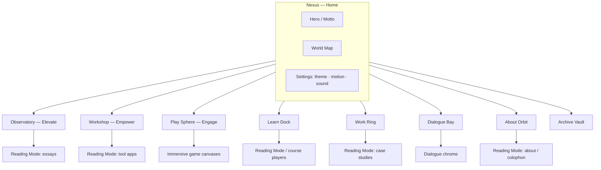

# Entertrainer Revamp — Design Spec (Phase 1)

**Status:** Build-ready · Design only (no app code changes in this phase)  
**Owner / author of site:** Naveen Jose  
**Live:** https://entertrainer.in · Preview: https://entertrainer-six.vercel.app  
**Repo audited:** `the-entertrainer/entertrainer` @ `main` (cloned `/workspace/entertrainer-revamp`)  
**Stack:** Nuxt 3 + Vue, Tailwind v4 (`@tailwindcss/vite`), Pinia, PWA (`@vite-pwa/nuxt`), three.js `^0.163`, ogl `^1.0.11`, GSAP `^3.15` (installed; GSAP/ogl largely unused in app code today — three.js powers Stack, Backdrop3d, AstroClock)  
**Audience (priority):** (1) Instructional designers & L&D professionals · (2) Curious general readers  
**Voice (binding):** Clear, grounded, curious — `ideas.md`  
**Date:** 2026-11-05 (Asia/Calcutta)

---

## Decisions log

Approved 2026-11-05. These are closed. They are not open questions.

1. **Syne** is the World display face.
2. Migrating off `html { font-size: 1px }` is approved. A rem-based scale (standard `16px` root) is a decided implementation requirement.
3. EasyMCQ and Draftly are **deleted**, not folded into another tool. Their old routes are removed (§5.2): 301 to the closest hub, or 410. The status code is an engineering choice.
4. WASM and model download sizes are **TBD**. Engineers measure them during the build. UI copy that states a size uses the placeholder `{size}`.
5. `/my-work` is renamed to `/work` **now**. `/my-work` and every sub-path 301 to the matching `/work` path.
6. Restyling the PaperSignal SVGs to cobalt is approved.

---

## 0. How to read this spec

1. **THE ONE CONCEPT** is an immersive, navigable 3D sci-fi world (Section 2). It is the creative north star for chrome, home, zone hubs, and transitions.
2. **Reading Mode** is a calm, high-contrast 2D content layer for essays, courses, lessons, tools, and About. World → Reading Mode is a deliberate handoff, not a fight.
3. Binding illustration DNA from `AGENTS.md` (cream / ink / one cobalt, hatching, bans) **governs Elevate heroes, Paper Signal diagrams, and Reading Mode surfaces**. PaperSignal SVGs are restyled to cobalt (decided). The World Layer may use an expanded sci-fi palette and materials, but must never violate the bans on anime, neon-candy rainbows, or multi-accent decoration inside content.
4. **Keep existing content** other than the two Empower tools deleted in the Decisions log. IA consolidates sprawl. Surviving URLs redirect. `/my-work` and every sub-path 301 to `/work` now.
5. Empower is rebuilt as **eight everyday client-side tools** (Section 7), offline-capable via PWA.

---

## 1. Audit summary

### 1.1 What exists now

Entertrainer is Naveen Jose’s publication: **Elevate** (essays), **Empower** (tools), **Engage** (games), plus learning routes (instructional-design, AI Atlas, Strong), portfolio (SEWA, Strong), Dialogue (comics), Lab (15 liquid-glass homepage experiments), Compose (gated CMS), Colophon.

| Layer | Source | Notes |
|---|---|---|
| Design tokens | `assets/css/main.css` | Editorial system; `html { font-size: 1px }` so `1rem ≈ 1px`. **Decided:** migrate off this hack to a rem-based scale (§6.3, build order). Live accent drifted to **signal yellow `#FFD43B`**; preloader still uses cream `#F7F1E4` + cobalt (`components/ed/Preloader.vue`). |
| Binding art direction | `AGENTS.md` | Cream `#F7F1E4` · ink `#0B0B0C` · cobalt `#2F5BD8`; hatching/stipple; ban anime / glossy-3D-kitsch / neon candy / multi-accent rainbows. |
| Direction intent | `ideas.md` | Swiss editorial minimalism, five-bar signal, Fraunces / Archivo / Source Serif 4, “Clear, grounded, curious.” |
| Fonts | `assets/css/fonts.css` | Self-hosted OFL: Fraunces, Archivo, Source Serif 4, IBM Plex Mono. |
| Primary nav | `content/editorial.ts` → `NAV` | Elevate, Empower, Engage, About me. |
| Masthead / footer | `components/ed/Masthead.vue`, `Footer.vue` | Skip link, theme, settings, WOTD; footer mailto + colophon. |
| Content indexes | `content/blogs.ts` (9 posts), composed “Are we in a simulation?”, `content/editorial.ts` ITEMS, `content/navigation.json` | |
| 3D today | `components/work/Backdrop3d.vue`, `composables/stack/useStackEngine.ts`, AstroClock 3D clocks, `utils/liquidGlass.ts` (raw WebGL SDF glass for `/lab`) | Ambient spheres / game / clocks / lab — not a site-wide world. |
| Prior audits | `docs/whole-site-design-audit.md`, `docs/site-architecture-redesign.md`, `docs/no-miss-design-system.md`, `docs/wcag-22-audit.md` | Sprawl, competing heroes, saturated category frames, tool shell framed like an article. |

### 1.2 Current problems

| Problem | Evidence | Impact |
|---|---|---|
| **Sprawl / duplication** | `/blogs`→`/elevate`, `/tools`→`/empower`, `/my-work`→about anchor, `/downloads`→`/`, dead Engage game redirects in `nuxt.config.ts` / `vercel.json`; tools also at `/tools/*` while hub is `/empower` | Confusing IA; SEO debt already patched with 301s but mental model is messy. |
| **Inconsistent accent systems** | Yellow Paper Signal in `main.css` vs cobalt in `AGENTS.md` / preloader vs violet Route Atlas in older docs | Brand reads as three sites. **Decided:** restyle PaperSignal SVGs to cobalt. |
| **Category colour sprawl** | `--cat-*` mapped many hues; several aliased to yellow | Category before content (`docs/whole-site-design-audit.md`). |
| **Homepage jobs overload (historical)** | Audits; current `pages/index.vue` is a quieter quote + switchboard (good), but no memorable 3D identity | Live hero is knowledge quote (“Truth alone triumphs.” / Mundaka Upanishad) — strong voice, weak spatial memory. |
| **Tools under-served for general audience** | Empower lists only EasyMCQ + Draftly (`pages/empower/index.vue`); Cadence/StoryGen exist as pages but aren’t hub-first; Dialogue/Whatto are side quests | L&D visitors can’t find “useful everyday tools.” |
| **Perf / weight** | Heavy deps (Playwright/Chromium server, three, konva, pdf stack, tesseract, React island for AstroClock) with no tiered client loading strategy for a site-wide 3D shell | Risk of poor LCP/INP on phones if World Layer ships without tiers. |
| **Lab / glass-lab unlisted** | `pages/lab/index.vue` noindex; chrome stripped in `app.vue` | Fine as sandbox; must not compete with primary IA. |

### 1.3 Route-by-route inventory (current → content)

| Current route | File(s) | Content held | Public? |
|---|---|---|---|
| `/` | `pages/index.vue` | Rotating knowledge quote + Elevate/Empower/Engage/About switchboard | Yes |
| `/elevate` | `pages/elevate/index.vue` | Essay index, MUST filters (Mind/Universe/Science/Technology), sort | Yes |
| `/elevate/:slug` | dedicated Vue pages + `[slug].vue` + composed API | 9 hand-built essays + composed posts (e.g. simulation) | Yes |
| `/empower` | `pages/empower/index.vue` | EasyMCQ, Draftly cards from `editorial.ts` | Yes |
| `/tools` | stub | 301 → `/empower` | Redirect |
| `/tools/easymcq` | `pages/tools/easymcq.vue` | Quiz distractor tool | Yes |
| `/tools/better-emails` | Draftly | Email polish | Yes |
| `/tools/cadence` | calendar tool | Exists; not on Empower hub | Yes |
| `/tools/storygen` | StoryGen | Storyboard tool; not on Empower hub | Yes |
| `/engage` | `pages/engage/index.vue` | Stack, Mind Reader, AstroClock | Yes |
| `/engage/stack` | three.js stacker | Game | Yes |
| `/engage/read-my-mind` | mind reader | Game | Yes |
| `/engage/astroclock` | React island + three | Birth chart clock | Yes |
| `/engage/whatto` | Whatto | Crypto signals; **noindex** | Unlisted |
| `/about` | `pages/about/index.vue` | Naveen’s full narrative (Kerala → hotels → SEWA → Marriott → Concentrix) | Yes |
| `/about/:slug` | slug page | Legacy | Keep via redirect map |
| `/instructional-design` | interactive lesson | Flagship ID demo (~4 min) | Yes |
| `/lessons` | lessons landing | Links to ID lesson + AI Atlas | Yes |
| `/courses/ai-atlas` | AI course player | “From No AI to Know AI” (~95 min) | Yes |
| `/my-work` | redirect | → `/about#sewa-chronicles` | Redirect |
| `/my-work/sewa-chronicles` | case study + book reader | SEWA Chronicles | Yes |
| `/my-work/strong` | Strong module | Password strength explainer | Yes |
| `/my-work/:slug` | ConstructionZone | Placeholder | Soft-retire |
| `/dialogue/*` | comics app | Pocket comics (Dexie) | Yes (app chrome) |
| `/downloads`, `/downloads/:slug` | redirect / stubs | Nav JSON still lists templates/frameworks/resources | Consolidate |
| `/lab`, `/lab/g01`–`g15` | Liquid Glass concepts | noindex experiments | Sandbox |
| `/glass-lab` | shader playground | noindex | Sandbox |
| `/compose` | gated editor | noindex CMS | Private |
| `/colophon` | how site is built | Tech/colophon essay | Yes |
| `/blogs`, `/blogs/:slug` | redirects | → Elevate | Redirect |
| Many `/engage/*` retired games | `nuxt.config` routeRules | → `/engage` | Redirect |

---

## 2. THE ONE CONCEPT — **SATYA SPACE**

### 2.1 Name

**Satya Space** (working title: *the Satya Field*).  
*Satya* = truth — echoing the live hero line **“Truth alone triumphs.”** (`content/knowledge-quotes.ts`, Mundaka Upanishad / Satyameva Jayate), without lion-capital kitsch.

### 2.2 Metaphor

A **navigable orbital archive**: a dark, quiet cosmos of matte architecture and luminous truth-signal light. Three primary **zones** (Elevate · Empower · Engage) hang as distinct worlds off a still **Nexus** (home). Secondary sites (Work, Learn, Dialogue, About, Archive) are docks / satellites — always findable on the **World Map**, never equal-weight chrome spam.

Visitors **travel** between zones with cinematic but interruptible transitions. Essays and tools do not render as floating HUD panels of body text; they open **Reading Mode** — a calm sheet that docks to the world.

### 2.3 Why it fits

| Pillar | Zone character | Fit |
|---|---|---|
| Elevate | Observatory / library ring — slow light, long sightlines | Essays that “start in a room and refuse the tidy story” (`pages/index.vue` tip) |
| Empower | Workshop / fabricator bay — modular benches, tool racks | Everyday tools; clear, grounded utility |
| Engage | Play sphere / gravity garden — kinetic but readable | Stack, Mind Reader, AstroClock |
| Truth motto | Nexus monolith inscription + optional ambient | Cultural resonance via idea of *satya*, not patriotic seal art |
| L&D audience | Learn Dock with courses/lessons prominent on map | ID/L&D reach Practice + AI Atlas in ≤2 taps |
| Brand bans | No anime mecha, no neon rainbow, no glossy toy plastic | Sci-fi as *architecture + light + material*, not candy HUD |

### 2.4 Alternative considered (rejected)

**“Paper Atlas”** — tactile hatched broadsheets / book-flip diorama in 3D.  
**Why rejected (Naveen direction lock):** Strong continuity with `AGENTS.md` print DNA, but not the requested visionary navigable world. Paper language is **retained inside Reading Mode, Elevate heroes, and tool empty-states**, not as the site shell.

### 2.5 What “sci-fi UI” must avoid (anti-cliché)

| Avoid | Why |
|---|---|
| Corner brackets, scrolling hex dumps, “SYSTEM ONLINE”, green terminal type | Instant generic “AI HUD” |
| Anime cockpit / mecha / holographic waifu chrome | Banned by `AGENTS.md` |
| Rainbow neon grids, purple–cyan vaporwave defaults | Neon candy / multi-accent ban |
| Chrome-beveled glossy plastic materials everywhere | Toy-like; fights “ultramodern” seriousness |
| Forcing essay body text into 3D panels | Destroys reading; fails a11y |
| Motion that gates content | Violates `ideas.md`: never hide essential info behind motion |

**Do instead:** architectural scale, restrained emissive cobalt edges, volumetric hush, typographic confidence, one signature mark (five-bar → spatial beacon).

---

## 3. Reference directions & moodboard

### 3.1 Named reference directions (aesthetics only — no URLs)

1. **Arrival (Denis Villeneuve) — linguistic monumentality**  
   Vast quiet volumes, soft volumetrics, type as architecture, alien intelligence without junk UI.

2. **Blade Runner 2049 — amber/teal restraint**  
   Sparse signage, atmospheric depth, one accent temperature; interiors feel designed not decorated.

3. **Halo Infinite / Infinite menu art direction (selected moments) — spatial OS**  
   World as menu: you walk to destinations. Borrow spatial clarity, not military HUD clutter.

4. **Designers’ modernist print + Swiss grid (Müller-Brockmann lineage)**  
   For Reading Mode: modular grids, ruthless hierarchy, φ-adjacent rhythm already in `main.css` Measure.

5. **Sachin Tendulkar… no.** Replace with **Indian modernist / National Institute of Design print sensibility + Upanishadic stillness**  
   Geometric clarity, cream paper memory in content, cosmic scale without temple-pastiche.

### 3.2 Moodboard (verbal)

- **World Layer:** near-black void `#07070A`, chalk-dust stars (sparse), cobalt emissive `#2F5BD8` / lifted `#7A9AE8` in dark, brushed-matte hulls (roughness high, metalness low), film grain 3–6%, subtle bloom on emissives only, rare chromatic aberration on transition peaks only.  
- **Nexus:** five-bar beacon extruded as a vertical light sculpture; motto set in display face, small.  
- **Reading Mode:** cream `#F7F1E4` sheet sliding over the void; ink `#0B0B0C`; cobalt rules/links; Fraunces titles; Source Serif body.  
- **Sound (optional, off by default):** low room tone + single soft “dock” transient on zone arrive; respect silent mode; preloader ident precedent in `utils/identAudioTrail.ts`.  
- **Texture:** world = micro-noise + matte; content = hatch/stipple illustrations per `AGENTS.md`.

---

## 4. World / zone map

### 4.1 Zones

| Zone ID | Name | Houses | Entry promise |
|---|---|---|---|
| `nexus` | Nexus | Home, World Map, theme/sound, skip-to-Reading | “Truth alone triumphs.” + three paths |
| `elevate` | Observatory | Essay index + articles (Reading Mode) | Essays · MUST |
| `empower` | Workshop | Empower hub + 8 tools (Reading Mode app shells) | Everyday tools, offline |
| `engage` | Play Sphere | Stack, Mind Reader, AstroClock (+ unlisted Whatto dock) | Short games |
| `learn` | Learn Dock | `/lessons`, `/instructional-design`, `/courses/ai-atlas`, Strong | L&D primary |
| `work` | Work Ring | SEWA Chronicles, Strong case entry, selected projects | Portfolio proof |
| `dialogue` | Dialogue Bay | Comics app | Pocket comics |
| `story` | About Orbit | `/about`, `/colophon` | Naveen’s route |
| `archive` | Archive Vault | Downloads pack, Lab link (noindex), Compose (auth) | Secondary |

### 4.2 Mermaid map



### 4.3 Spatial layout (designer brief)

Imagine the Nexus as a still octahedral dock. Three large rings at 120°: Elevate (zenith-forward), Empower (starboard), Engage (port). Learn Dock sits **between Elevate and Empower** (L&D shortcut). Work Ring nests under Elevate. Dialogue is a small bright bay off Empower. About is a long radial spine. Archive is below, dimmer.

Mobile: same graph as a **2D radial map sheet** (no forced 3D orbit); tap zone → transition → Reading Mode or game.

---

## 5. Proposed sitemap / IA

### 5.1 Primary nav

**Desktop (World chrome + Reading Mode top bar):**  
`Elevate` · `Empower` · `Engage` · `Learn` · `About`  
Secondary (overflow / footer / map only): `Work` (`/work`) · Dialogue · Colophon · Downloads · Lab

**Mobile:**  
Bottom bar (5): Elevate · Empower · Engage · Learn · Map  
Overflow sheet: About, Work (`/work`), Dialogue, Colophon, Settings

Public links and labels use `/work` now. `/my-work` is not in the nav. `/my-work` and every `/my-work/*` sub-path 301 to the matching `/work` path.

Rationale: L&D (`Learn`) is first-class; Empower is everyday-tools for everyone; Map replaces hamburger sprawl.

### 5.2 Current → new home

Essays, games, courses, and case studies stay. `/my-work` is renamed to `/work` now, with a 301 from `/my-work` and every sub-path. Two current tool routes are **Removed** (deleted, not folded into a new tool).

| Current | New home | Redirect |
|---|---|---|
| `/` | Nexus | — |
| `/elevate`, `/elevate/*` | Observatory + Reading Mode | keep |
| `/blogs`, `/blogs/*` | Elevate | keep existing 301s |
| `/empower` | Workshop hub | keep |
| `/tools` | `/empower` | keep 301 |
| `/tools/easymcq` | Removed | Deleted. 301 → `/empower` (closest hub) **or** 410. Engineering choice. |
| `/tools/better-emails` | Removed | Deleted. 301 → `/empower` (closest hub) **or** 410. Engineering choice. |
| `/tools/cadence`, `/tools/storygen` | Archive/Legacy under Empower “More” or Learn-adjacent | keep URLs; demote in hub |
| **New** `/empower/:tool` | 8 tools below | add |
| `/engage`, games | Play Sphere | keep |
| Retired engage games | `/engage` | keep 301s |
| `/engage/whatto` | Archive dock, still noindex | keep |
| `/lessons` | Learn Dock index | keep |
| `/instructional-design` | Learn Dock | keep |
| `/courses/ai-atlas` | Learn Dock | keep |
| `/my-work` | `/work` | 301 now |
| `/my-work/sewa-chronicles` | `/work/sewa-chronicles` | 301 now |
| `/my-work/strong` | `/work/strong` | 301 now (also linked from Learn) |
| `/my-work/*` | `/work/*` | 301 now, every sub-path, path-for-path |
| `/about` | About Orbit | keep |
| `/dialogue/*` | Dialogue Bay | keep |
| `/downloads/*` | `/archive/downloads` | 301 |
| `/colophon` | About Orbit secondary | keep |
| `/lab/*`, `/glass-lab`, `/compose` | Archive / private | keep noindex |
| `/educate/*` | `/` | keep 301 |

### 5.3 URL scheme (target)

```
/                       Nexus
/elevate                Observatory
/elevate/:slug          Essay (Reading Mode)
/empower                Workshop hub
/empower/plain-speak
/empower/goal-shaper
/empower/talk-track
/empower/snap-to-text
/empower/pdf-kit
/empower/access-check
/empower/recall-cards
/empower/decision-matrix
/engage                 Play Sphere
/engage/:game           Games
/learn                  Lessons + courses index
/instructional-design   (keep)
/courses/ai-atlas       (keep)
/work                   Projects index (public path now; replaces /my-work)
/work/sewa-chronicles
/work/strong
# /my-work and /my-work/* 301 to /work and /work/*
/dialogue/...
/about
/colophon
/archive/downloads
```

---

## 6. Design system

### 6.1 Dual-layer tokens

**A. World Layer (sci-fi shell)** — custom identity for immersion.  
**B. Reading Mode (content)** — binding cream/ink/cobalt from `AGENTS.md`.

### 6.2 Colour

#### Reading Mode (binding)

| Token | Hex | OKLCH (approx) | Role |
|---|---|---|---|
| `--rm-cream` | `#F7F1E4` | oklch(0.96 0.02 95) | Paper |
| `--rm-cream-2` | `#EFE8D8` | oklch(0.93 0.025 95) | Sunken |
| `--rm-ink` | `#0B0B0C` | oklch(0.12 0.005 280) | Text |
| `--rm-muted` | `#5C574E` | oklch(0.45 0.015 85) | Secondary text |
| `--rm-line` | `#C9C2B4` | oklch(0.82 0.02 95) | Hairline (non-text) |
| `--rm-cobalt` | `#2F5BD8` | oklch(0.52 0.17 265) | **Only** accent |
| `--rm-cobalt-ink` | `#1E3F9A` | oklch(0.42 0.15 265) | Text-on-cream links/buttons if needed |
| `--rm-danger` | `#C0392B` | — | Errors (≥4.5:1 on cream) |

**Contrast (WCAG AA):**

| Pair | Ratio | AA normal |
|---|---|---|
| ink on cream | **17.48:1** | Pass |
| muted on cream | **6.37:1** | Pass |
| cobalt on cream | **5.17:1** | Pass (large+normal) |
| white `#FFF` on cobalt | **5.82:1** | Pass |
| cream on ink | **17.48:1** | Pass |
| ink on cobalt | 3.38:1 | **Fail** for body — use white/cream on cobalt fills, not ink |

Dark Reading Mode: invert paper→`#16140F`, ink→cream, cobalt lift→`#7A9AE8` (7.13:1 on ink).

#### World Layer

| Token | Hex | Role |
|---|---|---|
| `--wx-void` | `#07070A` | Clear color / fog far |
| `--wx-hull` | `#12131A` | Architecture |
| `--wx-hull-2` | `#1A1C28` | Panels |
| `--wx-emissive` | `#2F5BD8` | Beacon / path |
| `--wx-emissive-soft` | `#7A9AE8` | Secondary glow |
| `--wx-star` | `#E8E4DC` | Sparse stars |
| `--wx-fog` | `#0B0C12` | Exp fog |
| `--wx-warning` | `#E8C547` | Rare status (not brand fill) |

World may use **warm hull undertones** and **one** emissive family (cobalt). No second accent rainbow.

**PaperSignal SVGs (decided):** restyle yellow brand fills to cobalt (`#2F5BD8`) and cream. One accent only.

### 6.3 Typography

**Reading Mode (keep self-hosted):**

| Role | Family | Notes |
|---|---|---|
| Display | **Fraunces** (variable, SOFT/WONK) | Titles — already in `fonts.css` |
| UI | **Archivo** | Nav, labels, tools |
| Body | **Source Serif 4** | Essays |
| Meta | **IBM Plex Mono** | Stamps, MUST letters |

**World Layer (add, Google Fonts or self-host OFL):**

| Role | Family | Why |
|---|---|---|
| World display | **Syne** (decided) | Geometric, ultramodern, not Inter |
| World UI | **IBM Plex Sans** | Technical calm; pairs with existing Mono |
| Do not use | Inter, Space Grotesk, Roboto | Generic AI look |

Fluid type (Reading Mode) is a **rem-based scale**. Migrating off `html { font-size: 1px }` is a decided implementation requirement: restore a standard `16px` root so `1rem = 16px`, and express type in rem. Do not keep the 1px root or px-equivalent clamps.

```css
--text-meta: clamp(0.6875rem, 0.65rem + 0.15vw, 0.75rem);
--text-body: clamp(1.0625rem, 1rem + 0.25vw, 1.1875rem);
--text-dek: clamp(1.25rem, 1.1rem + 0.6vw, 1.75rem);
--text-h2: clamp(1.5rem, 1.25rem + 1vw, 2.25rem);
--text-h1: clamp(2rem, 1.5rem + 2vw, 3.5rem);
--text-hero: clamp(2.5rem, 1.75rem + 3.5vw, 5.5rem);
```

### 6.4 Spacing, radii, elevation, grid

- Spacing scale: 4 / 8 / 12 / 16 / 24 / 40 / 64 / 104 (φ-ish, aligns with existing 8–13–21–34–55–89).  
- Radii: Reading `4 / 8 / 12`; World architecture mostly **2–6px** or hard chamfer — avoid blob UI.  
- Shadows: Reading — hairline + rare sticky; World — contact shadow in 3D, not CSS glow spam.  
- Breakpoints: `sm 640` · `md 768` · `lg 1024` · `xl 1280` · `2xl 1536`.  
- Content max: Reading `66ch` body; shell `1200px`.  
- Icons: stroke 1.25–1.5; Phosphor or custom SVG; **no emoji** (repo policy).  
- Imagery: Elevate keeps hatch/stipple cobalt covers (`AGENTS.md`). PaperSignal SVGs are restyled to cobalt (decided).

### 6.5 Tailwind v4 `@theme` block (ready)

```css
@import "tailwindcss";

@theme {
  --color-rm-cream: #F7F1E4;
  --color-rm-cream-2: #EFE8D8;
  --color-rm-ink: #0B0B0C;
  --color-rm-muted: #5C574E;
  --color-rm-line: #C9C2B4;
  --color-rm-cobalt: #2F5BD8;
  --color-rm-cobalt-ink: #1E3F9A;
  --color-rm-danger: #C0392B;

  --color-wx-void: #07070A;
  --color-wx-hull: #12131A;
  --color-wx-hull-2: #1A1C28;
  --color-wx-emissive: #2F5BD8;
  --color-wx-emissive-soft: #7A9AE8;
  --color-wx-star: #E8E4DC;

  --font-display: "Fraunces", Georgia, serif;
  --font-ui: "Archivo", "Helvetica Neue", Arial, sans-serif;
  --font-reading: "Source Serif 4", Georgia, serif;
  --font-mono: "IBM Plex Mono", ui-monospace, monospace;
  --font-world: "Syne", "Archivo", sans-serif;
  --font-world-ui: "IBM Plex Sans", "Archivo", sans-serif;

  --radius-xs: 0.25rem;
  --radius-sm: 0.5rem;
  --radius-md: 0.75rem;

  --shadow-sticky: 0 1px 0 var(--color-rm-line);
  --shadow-overlay: 0 24px 60px -24px rgb(0 0 0 / 0.45);

  --animate-dock-in: dock-in 420ms cubic-bezier(0.22, 0.82, 0.32, 1) both;
}

@custom-variant dark (&:where([data-theme="dark"], [data-theme="dark"] *));

@keyframes dock-in {
  from { opacity: 0; transform: translateY(12px); }
  to { opacity: 1; transform: none; }
}
```

Dark Reading Mode overrides on `[data-theme="dark"]` as in Section 6.2.

**Root (decided):** do not set `html { font-size: 1px }`. Use the browser default `16px` root so the rem tokens above are a true rem scale.

---

## 7. Empower — eight everyday tools (full specs)

**Positioning:** “Everyday tools for clearer thinking and work.” Useful to everyone; L&D gets extras (Goal Shaper learning-objective mode) without excluding general users.  
**Hard requirements:** client-side · private · **offline** (PWA caches tool routes, WASM/models). Show an **offline-ready** indicator and first-load download messaging. WASM and model download sizes are **TBD** — engineers measure them during the build. UI copy that states a size uses `{size}`.

### 7.1 Hub UX (`/empower`)

- **Hero (Reading Mode docked in Workshop):** title “Empower”, deck “Everyday tools for clearer thinking and work. They run in your browser — private, and available offline once loaded.”
- **Task groups:** Write · Read · Decide · Learn  
- **Search** (filter by name/task)  
- **Recently used** (IndexedDB via Dexie)  
- **Offline pill:** `Ready offline` | `Needs download ({size})` | `Offline — limited`  
- **More:** Cadence, StoryGen (keep URLs; demoted on the hub)

| Group | Tools |
|---|---|
| Write | Plain-Speak Meter, Talk Track |
| Read | Snap-to-Text, PDF Kit, Access Check |
| Decide | Goal Shaper, Decision Matrix |
| Learn | Recall Cards (+ Goal Shaper LO mode link) |

Avoid 3-equal-card rainbow grids; use **task rows** + asymmetric featured “Recently used”.

### 7.2 Shared tool-shell pattern

- Compact app chrome (not full magazine footer inside workspace) — addresses `docs/whole-site-design-audit.md`.  
- States: Empty · Loading (skeleton) · Ready · Working · Result · Error · Offline-blocked (if WASM missing) · Offline-ok.  
- Persistence: Dexie (`empower-tools` DB).  
- Export: file-saver / Clipboard / share sheet; **no server**.  
- A11y: labelled fields, `aria-live` for scores/status, focus trap in dialogs, 44px targets.  
- Micro: press `scale(0.98)` on primary; no content-hiding motion.

### 7.3 Tool-by-tool

#### 1) Plain-Speak Meter — `/empower/plain-speak`

| | |
|---|---|
| **Purpose** | Score readability; highlight jargon & long sentences; suggest simpler wording |
| **Inputs** | Paste or type text; optional file `.txt`/`.docx` (mammoth) |
| **Outputs** | Grade level / clarity score; highlighted text; suggestion list; copy “plain” rewrite |
| **Libs** | Custom readability heuristics; `mammoth` for docx |
| **Mobile** | Stacked: editor → score bar sticky → highlights list |
| **Desktop** | Split: editor \| diagnostics |
| **States** | Empty CTA “Paste anything you want clearer”; Working analyze debounce 300ms; Result; Error unsupported file |
| **Micro** | Highlight fade-in; suggestion chips press |
| **Export** | Copy plain text; download `.txt` |
| **Persist** | Last draft |
| **A11y** | Highlights also listed as text alternatives; score in `aria-live="polite"` |
| **Microcopy** | “Paste a draft. We’ll mark the fog.” / “Long sentence” / “Try: …” |

#### 2) Goal Shaper — `/empower/goal-shaper`

| | |
|---|---|
| **Purpose** | Vague goal → SMART goal + steps; **Learning-objective mode** (Bloom’s) for teachers/IDs |
| **Inputs** | Goal text; mode toggle Personal/Work/Learning; optional deadline |
| **Outputs** | SMART statement; step list; in LO mode: audience, behaviour, condition, degree + Bloom level |
| **Libs** | Local templates/rules (no LLM required for v1); optional on-device assist later |
| **Layout** | Wizard steps (Goal → Mode → Refine → Plan) |
| **Export** | Copy / `.txt` / PNG summary (html2canvas or satori server-optional — prefer client canvas) |
| **Persist** | Goals library |
| **Microcopy** | “What are you trying to make true?” / “Learning mode uses Bloom’s verbs — still plain language.” |

#### 3) Talk Track — `/empower/talk-track`

| | |
|---|---|
| **Purpose** | PPTX upload or pasted outline → speaker notes / narration + per-slide timing |
| **Inputs** | `.pptx` (JSZip + XML parse) or outline markdown |
| **Outputs** | Per-slide notes; estimated seconds; total seat time; export notes `.docx` (docx lib) or `.txt` |
| **Libs** | `jszip`, `docx`, `file-saver` (pptxgenjs optional for export decks) |
| **Mobile** | Upload first; accordion slides |
| **Desktop** | Slide list \| notes editor \| timing sidebar |
| **Microcopy** | “Drop a deck. Get words you’d actually say.” |

#### 4) Snap-to-Text — `/empower/snap-to-text`

| | |
|---|---|
| **Purpose** | On-device OCR from camera or upload (pages, receipts, whiteboards) |
| **Inputs** | Camera capture / image upload |
| **Outputs** | Editable text; copy; download `.txt` |
| **Libs** | `tesseract.js` (WASM; cache in SW) |
| **First-load** | Message: “OCR pack {size} — download once for offline use.” Size is TBD until engineers measure it in the build. |
| **Mobile** | Camera primary; permission copy honest |
| **A11y** | Canvas/img alt = “Source photo”; results in textbox |
| **Microcopy** | “Photo to text. Leaves your device.” |

#### 5) PDF Kit — `/empower/pdf-kit`

| | |
|---|---|
| **Purpose** | Merge, split, compress, reorder, sign PDFs on-device |
| **Inputs** | One or more PDFs |
| **Outputs** | Processed PDF download |
| **Libs** | `pdf-lib`, `pdfjs-dist` (preview), `file-saver` |
| **UI** | Tool tabs; page filmstrip drag-reorder; signature pad |
| **Microcopy** | “PDFs that never go to a server.” |

#### 6) Access Check — `/empower/access-check`

| | |
|---|---|
| **Purpose** | Accessibility checks for PDF & DOCX |
| **Inputs** | `.pdf` / `.docx` |
| **Outputs** | Issue list (severity, headings, alt text missing, contrast hints); severity; export report `.txt`/`.json` |
| **Libs** | `pdfjs-dist`, `mammoth` (docx HTML intermediate), custom rules |
| **Honest scope** | Spec must label “heuristic client checks — not a full WCAG audit certificate” |
| **Microcopy** | “A first pass before the formal audit.” |

#### 7) Recall Cards — `/empower/recall-cards`

| | |
|---|---|
| **Purpose** | Spaced-repetition flashcards from pasted notes |
| **Inputs** | Notes paste; optional delimiter; import JSON |
| **Outputs** | Deck; study session; progress |
| **Libs** | Dexie; SM-2 or similar local algorithm |
| **Export** | JSON / CSV |
| **Microcopy** | “Paste notes. Remember them later.” |

#### 8) Decision Matrix — `/empower/decision-matrix`

| | |
|---|---|
| **Purpose** | Weighted options × criteria; clear winner; shareable result |
| **Inputs** | Options, criteria, weights (sum 100) |
| **Outputs** | Scores; winner; share via URL-encoded state **and/or** PNG |
| **Libs** | None critical; `file-saver` / Clipboard |
| **Microcopy** | “Name the options. Weight what matters. See what wins.” |

### 7.4 Offline / PWA messaging

- Precache tool shells + vendor chunks for pdfjs/tesseract/pdf-lib.  
- UI: `Offline ready` checkmark in hub header after packs installed.  
- WASM and model pack sizes (tesseract, pdfjs, and any other downloads) are **TBD**. Engineers measure them during the build. Do not print a guessed number.  
- If user opens Snap-to-Text offline without WASM: blocking empty state with “Connect once to download the OCR pack ({size}).”  
- No account. No analytics DB (colophon promise).

### 7.5 Existing tools

EasyMCQ (`/tools/easymcq`) and Draftly (`/tools/better-emails`) are **deleted**. Do not fold them into Plain-Speak or any other tool. Remove their pages and hub cards. Old routes are Removed in §5.2 (301 to `/empower`, or 410 — engineering choice).

Cadence and StoryGen keep their URLs and sit under Empower “More” or Learn-adjacent.

---

## 8. Motion language

| Token | Value | Use |
|---|---|---|
| `--dur-tap` | 120ms | Press |
| `--dur-fast` | 220ms | Hover, chrome |
| `--dur-mid` | 420ms | Panels, Reading dock |
| `--dur-zone` | 900–1400ms | Zone travel (Tier 2–3) |
| `--ease-out` | cubic-bezier(.22,.82,.32,1) | Enter |
| `--ease-in` | cubic-bezier(.7,0,.84,0) | Exit |
| `--ease-expo` | cubic-bezier(.19,1,.22,1) | Zone camera |

**Choreography:** Nexus motto settles → zone beacons breathe (opacity only on Tier 1) → user selects → camera docks → Reading Mode sheet rises.  
**Scroll:** Reading Mode = document scroll (restore `app.vue` publication insight). World Layer = pointer/gyro orbit, not scroll-hijack on mobile.  
**Page transitions:** shared element beacon → zone color temperature shift.  
**prefers-reduced-motion / `data-reduce-motion`:** skip camera paths; crossfade maps; freeze parallax; **content visible immediately** (`ideas.md`, existing `main.css` reduce rules).

---

## 9. Page-by-page layouts (mobile → desktop)

### 9.1 Nexus `/`

**Mobile:** Full-bleed World Tier (or poster Tier 0) → motto + attribution → 3 zone buttons → Learn shortcut → “Open map”.  
**Desktop:** Spatial Nexus; hover previews zone blurb; Map hotkey `M`.  
**Sections:** Hero motto · Zone triad · Learn dock CTA · Selected work (SEWA, AI Atlas, ID lesson) · Footer.  
**3D:** Yes (Nexus scene).  
**Components:** `WorldCanvas`, `ZoneBeacon`, `WorldMapSheet`, `RmDock`, Masthead compact, Footer.

### 9.2 Elevate index

Reading Mode list (MUST filters + sort) over dimmed Observatory skybox (Tier 2+) or static hatch header (Tier 0–1). Cards title-first; cobalt rule only.

### 9.3 Elevate article

Tajjalan shape per `AGENTS.md`: margin note, drop-cap, 2–3 headings, blockquote, closing question, sources. No World chrome competing with measure.

### 9.4 Empower hub + tools

Per Section 7; Workshop skybox ambient only. The eight tools only. No layout for the removed tool routes in §5.2.

### 9.5 Engage hub + games

Hub in Reading/World hybrid; games stay immersive canvases (Stack three.js) with exit to Sphere.

### 9.6 Learn `/learn`

List: Instructional Design (4 min), AI Atlas (95 min), Strong (10 min). Primary for L&D.

### 9.7 Work `/work`, `/work/sewa-chronicles`, `/work/strong`

Public routes are `/work` now. Nav, in-page links, and headings use `/work`. `/my-work` and every `/my-work/*` sub-path 301 to the matching `/work` path.

Case study Reading Mode; SEWA keeps BookReader at `/work/sewa-chronicles`; Strong keeps the module player at `/work/strong` (chrome-less per `app.vue`).

### 9.8 About / Colophon

Narrative + facts; portrait treatment once (audit).

### 9.9 Dialogue

Keep app shell; Bay transition into existing UI.

### 9.10 Archive / Downloads / Lab / Compose

Utility Reading Mode; Lab remains noindex sandbox (Liquid Glass experiments inform shaders but are not the product UI).

---

## 10. 3D placement, libraries, budgets, tiers

### 10.1 Where 3D lives

| Location | Library | Scene |
|---|---|---|
| Nexus, zone exteriors, transitions | **three.js** (primary) | Architectural docks, beacon, fog, sparse stars |
| Stack game | three.js (existing) | Keep |
| AstroClock | three.js + React island | Keep |
| Lab | raw WebGL liquidGlass | Sandbox only |
| ogl | optional lite path | Consider for Tier 1 particle field if three too heavy — **default stay three.js one engine** |
| GSAP | zone camera timelines + UI | ScrollTrigger only in Reading Mode optional reveals |

**Materials:** MeshStandard/Physical with **high roughness**, low metalness; emissive cobalt accents; optional custom fragment for grain.  
**Post (Tier 3 only):** bloom (emissives), film grain, very mild CA on transition apex (≤0.002), vignette. Tier 2: grain + vignette. Tier 1: none.  
**Interaction:** pointer drag orbit; scroll disabled for camera on mobile; **gyro** after explicit permission (iOS): non-blocking prompt “Use motion to look around? [Not now] [Enable]”.

### 10.2 Performance budgets

| Metric | Target |
|---|---|
| World JS gzip (Tier 2) | ≤ 180 KB incremental beyond base Nuxt |
| Draw calls Nexus | ≤ 80 |
| Triangles Nexus | ≤ 80k |
| FPS | 60 desktop / 30+ mid mobile |
| LCP (Reading entry) | ≤ 2.5s on mid phone |
| INP | ≤ 200ms |
| DPR | `min(devicePixelRatio, 1.5)` Tier 2; `1` Tier 1 |

### 10.3 Performance tiers

| Tier | Detection (any fail → lower) | Renders |
|---|---|---|
| **0** | `prefers-reduced-motion`, no WebGL, `Save-Data`, or software GL | Static poster frames + CSS; full Reading Mode; Map as 2D SVG |
| **1 Lite** | WebGL ok but `deviceMemory≤4` or `hwConcurrency≤4` or low FPS probe | Low-poly docks, unlit/emissive mats, no post, ≤20k tris, no gyro |
| **2 Standard** | Default modern phones | Full meshes, fog, soft emissives, simple shadow or baked AO, grain |
| **3 High** | Desktop / flagship + user “Quality: High” | Bloom, CA on transitions, reflections limited, gyro optional |

**FPS probe:** run 45 frames after first paint; if avg < 28 → drop tier.  
**Lazy-load:** `WorldCanvas` dynamic import only on routes that need it; tools/articles never load postprocessing stack.

### 10.4 Fallbacks ladder

Full 3D → Lite 3D → Static poster (hatch/cobalt art) → CSS gradient void → no-JS SSR Reading HTML.

---

## 11. Hero / intro storyboard

| Time | Desktop Tier 2–3 | Mobile | Reduced motion |
|---|---|---|---|
| 0.0s | Void + faint stars | Same | Static cream/void poster |
| 0.0–0.8s | Five-bar beacon extrudes (preloader may already have run once/session) | Beacon 2D morph | Instant mark + wordmark |
| 0.8–1.6s | Motto fades/rises: “Truth alone triumphs.” | Same, smaller type | Opacity only |
| 1.6–2.2s | Attribution “Mundaka Upanishad” | Same | Same |
| 2.2–3.2s | Three zone beacons ignite at 120° | Three buttons stack | Buttons visible immediately from t=0 |
| 3.2s+ | Idle breath on emissives; accept input anytime (interruptible) | Tap zones | No breath |

Skip control always. Session flag keeps preloader once per tab (existing pattern in `app.vue`).

---

## 12. Accessibility requirements

- Skip link → `#main` focusable (`docs/wcag-22-audit.md`).  
- World canvas: `role="img"` **or** application with accessible name; **visually hidden** text alternative describing zone and how to open Map.  
- Keyboard: `Tab` chrome, arrow keys zone list in Map dialog, `Enter` to travel, `Esc` closes sheets; games document their own keys.  
- Reading Mode: full screen reader path; headings hierarchy; 44×44 targets; focus 3px ink/cobalt.  
- Don’t rely on gyro/color alone.  
- Tool status via `aria-live`.  
- Contrast pairs Section 6.2.  
- Reduced motion / reduced transparency / more contrast media queries honored.

---

## 13. Component inventory

| Component | Purpose | Variants / states | Where | Reuse? |
|---|---|---|---|---|
| `WorldCanvas` | three.js shell | tiers 0–3 | Nexus, zone hubs | **New** |
| `ZoneBeacon` | Zone entry | idle/hover/focus/active | Nexus | **New** |
| `WorldMapSheet` | 2D/3D map | open/closed | Global | **New** |
| `RmDock` / `ReadingFrame` | Content sheet | docked/expanded | Articles, tools, about | **New** (wraps Shell) |
| `EdMasthead` | Nav | world/reading densites | Global | **Refactor** |
| `EdFooter` | Footer | — | Reading | **Reuse** |
| `EdWordmark` / `EdMark` | Identity | — | Global | **Reuse** (beacon sync) |
| `EdPreloader` | Intro | reduced | Home | **Refactor** timings |
| `EmpowerHub` | Tool directory | search/filter/offline | `/empower` | **New** |
| `ToolShell` | App chrome | empty/loading/… | 8 tools | **Refactor** `ui/ToolShell` |
| 8× tool apps | See §7 | — | `/empower/*` | **New** |
| `EdStageHero` | Section heroes | variants | Indexes | **Reuse**/tone down |
| `EdCard` | Cards | quiet | Indexes | **Refactor** |
| `Backdrop3d` | Ambient spheres | — | Strong etc. | **Reuse** selective |
| `LabGlass` | Liquid glass | — | Lab only | Keep sandbox |
| Dialogue/* | Comics | — | Dialogue | **Reuse** |
| Whatto/* | Unlisted | — | Whatto | **Reuse** |
| Course players | AI Atlas, ID, Strong | — | Learn | **Reuse** |

---

## 14. Sound (optional)

- Default **off**. Toggle in Settings + first soft ask only after user opens Sound.  
- Assets: extend ident trail; zone dock tick ≤150ms.  
- Mute when `document.hidden` or OS silent.

---

## 15. Implementation notes & phased build order

### Phase A — Foundations (FE)
1. Token migration: Reading Mode cream/ink/cobalt. Restyle PaperSignal SVGs from yellow to cobalt (decided).  
2. Migrate off `html { font-size: 1px }` to a rem-based scale with a standard `16px` root (decided implementation requirement).  
3. Tailwind `@theme` + dark variant. Ship **Syne** as the World display face (decided).  
4. `ReadingFrame` + masthead modes.  
5. Redirect table in `nuxt.config` / `vercel.json`. `/my-work` and `/my-work/*` 301 to `/work` and `/work/*` now. Removed tool routes: 301 to `/empower` or 410 (engineering choice).

### Phase B — IA & Empower (FE)
1. Learn routes. Ship `/work` now (index, SEWA, Strong) and 301 every `/my-work` path.  
2. Empower hub + 8 tools scaffolding + Dexie + SW caching plan.  
3. Offline indicators.

### Phase C — World (3D Eng)
1. Tier detector.  
2. Nexus scene + beacons.  
3. Zone skyboxes.  
4. Transitions + reduced-motion path.  
5. Gyro permission UX.  
6. Postprocessing gated Tier 3.

### Phase D — Integration (FE+3D)
1. Map sheet.  
2. Storyboard intro.  
3. Sound toggle.  
4. Perf passes.

### Phase E — QA
1. WCAG sample + keyboard world map.  
2. Tier forcing QA.  
3. Offline tool tests.  
4. LCP/INP on mid Android + iPhone Safari.

### Open questions / blockers

1. Compose/Lab remain noindex — confirm.  
2. No repo access blocker — clone succeeded.

---

## 16. Success criteria (Phase 1 design → Phase 2 build)

- Visitor can explain Entertrainer in one sentence after Nexus.  
- L&D user reaches a lesson/course in ≤2 taps.  
- General user finds an Empower tool for a daily task without knowing ID jargon.  
- Essays remain calmer than the world — Reading Mode passes contrast and reduced-motion.  
- Tier 0 usable; Tier 3 delightful; no content trapped in WebGL.

---

*End of DESIGN_SPEC.md — Phase 1*
