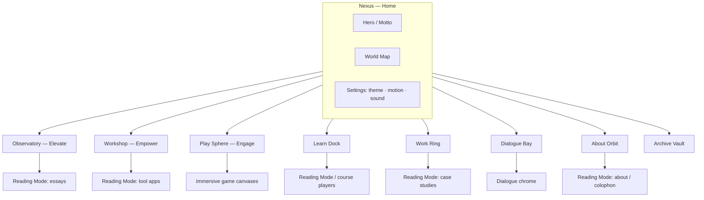

# Entertrainer Revamp — Design Spec (Phase 1)

**Status:** Build-ready · Design only (no app code changes in this phase)  
**Owner / author of site:** Naveen Jose  
**Live:** https://entertrainer.in · Preview: https://entertrainer-six.vercel.app  
**Repo audited:** `the-entertrainer/entertrainer` @ `main` (cloned `/workspace/entertrainer-revamp`)  
**Stack:** Nuxt 3 + Vue, Tailwind v4 (`@tailwindcss/vite`), Pinia, PWA (`@vite-pwa/nuxt`), three.js `^0.163`, ogl `^1.0.11`, GSAP `^3.15` (installed; GSAP/ogl largely unused in app code today — three.js powers Stack, Backdrop3d, AstroClock)  
**Audience (priority):** (1) Instructional designers & L&D professionals · (2) Curious general readers  
**Voice (binding):** Clear, grounded, curious — `ideas.md`  
**Date:** 2026-11-05 (Asia/Calcutta)

---

## Decisions log

Approved 2026-11-05. These are closed. They are not open questions.

1. **Syne** is the World display face.
2. Migrating off `html { font-size: 1px }` is approved. A rem-based scale (standard `16px` root) is a decided implementation requirement.
3. EasyMCQ and Draftly are **deleted**, not folded into another tool. `/tools/easymcq` and `/tools/better-emails` are **301 to `/empower`**. Not 410. Also drop their PWA shortcuts in `nuxt.config`.
4. WASM and model download sizes are **TBD**. Engineers measure them during the build. UI copy that states a size uses the placeholder `{size}`.
5. `/my-work` is renamed to `/work` **now**. `/my-work` and every sub-path 301 to the matching `/work` path. The live index 302 to `/about#sewa-chronicles` is replaced by that 301. Sub-paths that are live 200s (`/my-work/sewa-chronicles`, `/my-work/strong`) move path-for-path.
6. Restyling the PaperSignal SVGs to cobalt is approved.
7. `/learn` is canonical. `/lessons` and every `/lessons/*` sub-path 301 to the matching `/learn` path.
8. §5.2 is the one redirect list. One hop only, no loops. Checked 2026-11-05 against `https://www.entertrainer.in/sitemap.xml`, sampled live responses, `pages/**`, `content/navigation.json`, `nuxt.config.ts` `routeRules`, and `vercel.json`. `/downloads` goes straight to `/archive/downloads`. `/about/:slug` 301s to `/about`. Retired Elevate slugs, including `/elevate/the-sacred-frequencies-are-not-a-scale`, land on their final essay or the Elevate index. `/tools/training-cal-gen` 301s to `/tools/cadence`. `/tools/storyforge-id` 301s to `/tools/storygen`.
9. Archive Vault lands at `/archive`.
10. Contrast tokens are updated so normal text is at least 4.5:1, or the pair is limited to large text or non-text at 3:1. Table in §6.2. Dark muted is `#A89888`. Dark danger is `#E9786A`. Light danger is `#B33226`. World emissive is `#3D6AE0` and is not small text.
11. The global 404, the WebGL / `WorldCanvas` fallback, and screen-reader announcements for 3D are specified in §9.11, §10.5, and §12.
12. Compose, Lab, Glass Lab, and Whatto stay noindex.
13. Canonical routes have **no trailing slash**, site-wide. `/dialogue` is canonical. `/dialogue/` is `statusCode: 301` to `/dialogue` in one hop. Nuxt and Vercel use `trailingSlash: false`. A trailing-slash URL whose path without the slash already redirects goes straight to that final target.
14. A mid-session `webglcontextlost` swaps the live canvas to `WorldFallbackPoster`: `preventDefault`, at most one `webglcontextrestored` rebuild, then teardown. Announce on the live region. Keep focus and scroll. Dispose GL resources and remove the dead canvas (§10.5).
15. `RmError` and `WorldFallbackPoster` share one `ZoneLinks` list, in this order: Nexus `/`, Elevate `/elevate`, Empower `/empower`, Engage `/engage`, Learn `/learn`, Work `/work`, Dialogue `/dialogue`, About `/about`, Archive `/archive`.
16. Every path redirect in the matrix is `statusCode: 301` in both Nuxt `routeRules` and `vercel.json`. Do not use Vercel `"permanent": true` (that response is 308).

---

## 0. How to read this spec

1. **THE ONE CONCEPT** is an immersive, navigable 3D sci-fi world (Section 2). It is the creative north star for chrome, home, zone hubs, and transitions.
2. **Reading Mode** is a calm, high-contrast 2D content layer for essays, courses, lessons, tools, and About. World → Reading Mode is a deliberate handoff, not a fight.
3. Binding illustration DNA from `AGENTS.md` (cream / ink / one cobalt, hatching, bans) **governs Elevate heroes, Paper Signal diagrams, and Reading Mode surfaces**. PaperSignal SVGs are restyled to cobalt (decided). The World Layer may use an expanded sci-fi palette and materials, but must never violate the bans on anime, neon-candy rainbows, or multi-accent decoration inside content.
4. **Keep existing content** other than the two Empower tools deleted in the Decisions log. IA consolidates sprawl. Surviving URLs redirect. `/my-work` and every sub-path 301 to `/work` now.
5. Empower is rebuilt as **eight everyday client-side tools** (Section 7), offline-capable via PWA.

---

## 1. Audit summary

### 1.1 What exists now

Entertrainer is Naveen Jose’s publication: **Elevate** (essays), **Empower** (tools), **Engage** (games), plus learning routes (instructional-design, AI Atlas, Strong), portfolio (SEWA, Strong), Dialogue (comics), Lab (15 liquid-glass homepage experiments), Compose (gated CMS), Colophon.

| Layer | Source | Notes |
|---|---|---|
| Design tokens | `assets/css/main.css` | Editorial system; `html { font-size: 1px }` so `1rem ≈ 1px`. **Decided:** migrate off this hack to a rem-based scale (§6.3, build order). Live accent drifted to **signal yellow `#FFD43B`**; preloader still uses cream `#F7F1E4` + cobalt (`components/ed/Preloader.vue`). |
| Binding art direction | `AGENTS.md` | Cream `#F7F1E4` · ink `#0B0B0C` · cobalt `#2F5BD8`; hatching/stipple; ban anime / glossy-3D-kitsch / neon candy / multi-accent rainbows. |
| Direction intent | `ideas.md` | Swiss editorial minimalism, five-bar signal, Fraunces / Archivo / Source Serif 4, “Clear, grounded, curious.” |
| Fonts | `assets/css/fonts.css` | Self-hosted OFL: Fraunces, Archivo, Source Serif 4, IBM Plex Mono. |
| Primary nav | `content/editorial.ts` → `NAV` | Elevate, Empower, Engage, About me. |
| Masthead / footer | `components/ed/Masthead.vue`, `Footer.vue` | Skip link, theme, settings, WOTD; footer mailto + colophon. |
| Content indexes | `content/blogs.ts` (9 posts), composed “Are we in a simulation?”, `content/editorial.ts` ITEMS, `content/navigation.json` | |
| 3D today | `components/work/Backdrop3d.vue`, `composables/stack/useStackEngine.ts`, AstroClock 3D clocks, `utils/liquidGlass.ts` (raw WebGL SDF glass for `/lab`) | Ambient spheres / game / clocks / lab — not a site-wide world. |
| Prior audits | `docs/whole-site-design-audit.md`, `docs/site-architecture-redesign.md`, `docs/no-miss-design-system.md`, `docs/wcag-22-audit.md` | Sprawl, competing heroes, saturated category frames, tool shell framed like an article. |

### 1.2 Current problems

| Problem | Evidence | Impact |
|---|---|---|
| **Sprawl / duplication** | `/blogs`→`/elevate`, `/tools`→`/empower`, `/my-work` index **302**→`/about#sewa-chronicles` while `/my-work/sewa-chronicles` and `/my-work/strong` are **200**, `/downloads` index **302**→`/` while `/downloads/templates`, `/frameworks`, and `/resources` are **200**, dead Engage game redirects in `nuxt.config.ts` / `vercel.json`; tools also at `/tools/*` while hub is `/empower` | Confusing IA; SEO debt already patched with 301s but mental model is messy. |
| **Inconsistent accent systems** | Yellow Paper Signal in `main.css` vs cobalt in `AGENTS.md` / preloader vs violet Route Atlas in older docs | Brand reads as three sites. **Decided:** restyle PaperSignal SVGs to cobalt. |
| **Category colour sprawl** | `--cat-*` mapped many hues; several aliased to yellow | Category before content (`docs/whole-site-design-audit.md`). |
| **Homepage jobs overload (historical)** | Audits; current `pages/index.vue` is a quieter quote + switchboard (good), but no memorable 3D identity | Live hero is knowledge quote (“Truth alone triumphs.” / Mundaka Upanishad) — strong voice, weak spatial memory. |
| **Tools under-served for general audience** | Empower lists only EasyMCQ + Draftly (`pages/empower/index.vue`); Cadence/StoryGen exist as pages but aren’t hub-first; Dialogue/Whatto are side quests | L&D visitors can’t find “useful everyday tools.” |
| **Perf / weight** | Heavy deps (Playwright/Chromium server, three, konva, pdf stack, tesseract, React island for AstroClock) with no tiered client loading strategy for a site-wide 3D shell | Risk of poor LCP/INP on phones if World Layer ships without tiers. |
| **Lab / glass-lab unlisted** | `pages/lab/index.vue` noindex; chrome stripped in `app.vue` | Fine as sandbox; must not compete with primary IA. |

### 1.3 Route-by-route inventory (current → content)

| Current route | File(s) | Content held | Public? |
|---|---|---|---|
| `/` | `pages/index.vue` | Rotating knowledge quote + Elevate/Empower/Engage/About switchboard | Yes |
| `/elevate` | `pages/elevate/index.vue` | Essay index, MUST filters (Mind/Universe/Science/Technology), sort | Yes |
| `/elevate/:slug` | dedicated Vue pages + `[slug].vue` + composed API | 9 hand-built essays + composed posts (e.g. simulation) | Yes |
| `/empower` | `pages/empower/index.vue` | EasyMCQ, Draftly cards from `editorial.ts` | Yes |
| `/tools` | stub | 301 → `/empower` | Redirect |
| `/tools/easymcq` | `pages/tools/easymcq.vue` | Quiz distractor tool | Yes |
| `/tools/better-emails` | Draftly | Email polish | Yes |
| `/tools/cadence` | calendar tool | Exists; not on Empower hub | Yes |
| `/tools/storygen` | StoryGen | Storyboard tool; not on Empower hub | Yes |
| `/engage` | `pages/engage/index.vue` | Stack, Mind Reader, AstroClock | Yes |
| `/engage/stack` | three.js stacker | Game | Yes |
| `/engage/read-my-mind` | mind reader | Game | Yes |
| `/engage/astroclock` | React island + three | Birth chart clock | Yes |
| `/engage/whatto` | Whatto | Crypto signals; **noindex** | Unlisted |
| `/about` | `pages/about/index.vue` | Naveen’s full narrative (Kerala → hotels → SEWA → Marriott → Concentrix) | Yes |
| `/about/:slug` | `pages/about/[slug].vue` | `about` nav is empty. Unknown slugs **404** (live `/about/missing`). | 404 today |
| `/instructional-design` | interactive lesson | Flagship ID demo (~4 min) | Yes |
| `/lessons` | lessons landing | Live **200**. Links to the ID lesson and AI Atlas. Not in `sitemap.xml`. | Yes |
| `/courses/ai-atlas` | AI course player | “From No AI to Know AI” (~95 min). Live **200**. Not in `sitemap.xml`. | Yes |
| `/my-work` | `pages/my-work/index.vue` | Live **302** → `/about#sewa-chronicles`. Not a content page. | Redirect |
| `/my-work/sewa-chronicles` | case study + book reader | SEWA Chronicles. Live **200**, in the sitemap. Not a redirect. | Yes |
| `/my-work/strong` | Strong module | Password strength explainer. Live **200**, in the sitemap. Not a redirect. | Yes |
| `/my-work/:slug` | ConstructionZone | Placeholder. Unknown slugs **404** (live `/my-work/missing`). | 404 |
| `/dialogue` | routeRules | Live **308** → `/dialogue/`. Target IA flips this: `/dialogue` is canonical and `/dialogue/` 301s back. | Redirect today |
| `/dialogue/` and child routes | comics app | Pocket comics (Dexie). Live **200** on the slash form. | Yes (app chrome) |
| `/downloads` | `pages/downloads/index.vue` | Live **302** → `/`. | Redirect |
| `/downloads/templates`, `/downloads/frameworks`, `/downloads/resources` | ConstructionZone stubs | Live **200**. Listed in `content/navigation.json`. | Yes |
| `/tools/training-cal-gen` | routeRules + `vercel.json` | Live **301** → `/tools/cadence` | Redirect |
| `/tools/storyforge-id` | routeRules + `vercel.json` | Live **301** → `/tools/storygen` | Redirect |
| `/lab`, `/lab/g01`–`g15` | Liquid Glass concepts | noindex experiments | Sandbox |
| `/glass-lab` | shader playground | noindex | Sandbox |
| `/compose` | gated editor | noindex CMS | Private |
| `/colophon` | how site is built | Tech/colophon essay | Yes |
| `/blogs`, `/blogs/:slug` | redirects | → Elevate | Redirect |
| Many `/engage/*` retired games | `nuxt.config` routeRules | → `/engage` | Redirect |

---

## 2. THE ONE CONCEPT — **SATYA SPACE**

### 2.1 Name

**Satya Space** (working title: *the Satya Field*).  
*Satya* = truth — echoing the live hero line **“Truth alone triumphs.”** (`content/knowledge-quotes.ts`, Mundaka Upanishad / Satyameva Jayate), without lion-capital kitsch.

### 2.2 Metaphor

A **navigable orbital archive**: a dark, quiet cosmos of matte architecture and luminous truth-signal light. Three primary **zones** (Elevate · Empower · Engage) hang as distinct worlds off a still **Nexus** (home). Secondary sites (Work, Learn, Dialogue, About, Archive) are docks / satellites — always findable on the **World Map**, never equal-weight chrome spam.

Visitors **travel** between zones with cinematic but interruptible transitions. Essays and tools do not render as floating HUD panels of body text; they open **Reading Mode** — a calm sheet that docks to the world.

### 2.3 Why it fits

| Pillar | Zone character | Fit |
|---|---|---|
| Elevate | Observatory / library ring — slow light, long sightlines | Essays that “start in a room and refuse the tidy story” (`pages/index.vue` tip) |
| Empower | Workshop / fabricator bay — modular benches, tool racks | Everyday tools; clear, grounded utility |
| Engage | Play sphere / gravity garden — kinetic but readable | Stack, Mind Reader, AstroClock |
| Truth motto | Nexus monolith inscription + optional ambient | Cultural resonance via idea of *satya*, not patriotic seal art |
| L&D audience | Learn Dock with courses/lessons prominent on map | ID/L&D reach Practice + AI Atlas in ≤2 taps |
| Brand bans | No anime mecha, no neon rainbow, no glossy toy plastic | Sci-fi as *architecture + light + material*, not candy HUD |

### 2.4 Alternative considered (rejected)

**“Paper Atlas”** — tactile hatched broadsheets / book-flip diorama in 3D.  
**Why rejected (Naveen direction lock):** Strong continuity with `AGENTS.md` print DNA, but not the requested visionary navigable world. Paper language is **retained inside Reading Mode, Elevate heroes, and tool empty-states**, not as the site shell.

### 2.5 What “sci-fi UI” must avoid (anti-cliché)

| Avoid | Why |
|---|---|
| Corner brackets, scrolling hex dumps, “SYSTEM ONLINE”, green terminal type | Instant generic “AI HUD” |
| Anime cockpit / mecha / holographic waifu chrome | Banned by `AGENTS.md` |
| Rainbow neon grids, purple–cyan vaporwave defaults | Neon candy / multi-accent ban |
| Chrome-beveled glossy plastic materials everywhere | Toy-like; fights “ultramodern” seriousness |
| Forcing essay body text into 3D panels | Destroys reading; fails a11y |
| Motion that gates content | Violates `ideas.md`: never hide essential info behind motion |

**Do instead:** architectural scale, restrained emissive cobalt edges, volumetric hush, typographic confidence, one signature mark (five-bar → spatial beacon).

---

## 3. Reference directions & moodboard

### 3.1 Named reference directions (aesthetics only — no URLs)

1. **Arrival (Denis Villeneuve) — linguistic monumentality**  
   Vast quiet volumes, soft volumetrics, type as architecture, alien intelligence without junk UI.

2. **Blade Runner 2049 — amber/teal restraint**  
   Sparse signage, atmospheric depth, one accent temperature; interiors feel designed not decorated.

3. **Halo Infinite / Infinite menu art direction (selected moments) — spatial OS**  
   World as menu: you walk to destinations. Borrow spatial clarity, not military HUD clutter.

4. **Designers’ modernist print + Swiss grid (Müller-Brockmann lineage)**  
   For Reading Mode: modular grids, ruthless hierarchy, φ-adjacent rhythm already in `main.css` Measure.

5. **Sachin Tendulkar… no.** Replace with **Indian modernist / National Institute of Design print sensibility + Upanishadic stillness**  
   Geometric clarity, cream paper memory in content, cosmic scale without temple-pastiche.

### 3.2 Moodboard (verbal)

- **World Layer:** near-black void `#07070A`, chalk-dust stars (sparse), beacon emissive `#3D6AE0` (fills and lines only) / text and soft glow `#7A9AE8`, brushed-matte hulls (roughness high, metalness low), film grain 3–6%, subtle bloom on emissives only, rare chromatic aberration on transition peaks only.  
- **Nexus:** five-bar beacon extruded as a vertical light sculpture; motto set in display face, small.  
- **Reading Mode:** cream `#F7F1E4` sheet sliding over the void; ink `#0B0B0C`; cobalt rules/links; Fraunces titles; Source Serif body.  
- **Sound (optional, off by default):** low room tone + single soft “dock” transient on zone arrive; respect silent mode; preloader ident precedent in `utils/identAudioTrail.ts`.  
- **Texture:** world = micro-noise + matte; content = hatch/stipple illustrations per `AGENTS.md`.

---

## 4. World / zone map

### 4.1 Zones

| Zone ID | Name | Houses | Entry promise |
|---|---|---|---|
| `nexus` | Nexus | Home, World Map, theme/sound, skip-to-Reading | “Truth alone triumphs.” + three paths |
| `elevate` | Observatory | Essay index + articles (Reading Mode) | Essays · MUST |
| `empower` | Workshop | Empower hub + 8 tools (Reading Mode app shells) | Everyday tools, offline |
| `engage` | Play Sphere | Stack, Mind Reader, AstroClock (+ unlisted Whatto dock) | Short games |
| `learn` | Learn Dock | `/learn` (canonical). Links onward to `/instructional-design`, `/courses/ai-atlas`, and Strong. `/lessons` 301s here. | L&D primary |
| `work` | Work Ring | SEWA Chronicles, Strong case entry, selected projects | Portfolio proof |
| `dialogue` | Dialogue Bay | Comics app | Pocket comics |
| `story` | About Orbit | `/about`, `/colophon` | Naveen’s route |
| `archive` | Archive Vault | `/archive` index. Downloads live at `/archive/downloads`. Lab and Compose stay linked and noindex. | Secondary |

### 4.2 Mermaid map



### 4.3 Spatial layout (designer brief)

Imagine the Nexus as a still octahedral dock. Three large rings at 120°: Elevate (zenith-forward), Empower (starboard), Engage (port). Learn Dock sits **between Elevate and Empower** (L&D shortcut). Work Ring nests under Elevate. Dialogue is a small bright bay off Empower. About is a long radial spine. Archive is below, dimmer.

Mobile: same graph as a **2D radial map sheet** (no forced 3D orbit); tap zone → transition → Reading Mode or game.

### 4.4 ZoneLinks

One shared list. `RmError` (§9.11) and `WorldFallbackPoster` (§10.5) both render it, in this order, with these canonical URLs (no trailing slash). Define it once, for example `content/zone-links.ts`, and import it. Do not hand-copy the rows into either component.

| Order | Label | URL |
|---|---|---|
| 1 | Nexus | `/` |
| 2 | Elevate | `/elevate` |
| 3 | Empower | `/empower` |
| 4 | Engage | `/engage` |
| 5 | Learn | `/learn` |
| 6 | Work | `/work` |
| 7 | Dialogue | `/dialogue` |
| 8 | About | `/about` |
| 9 | Archive | `/archive` |

---

## 5. Proposed sitemap / IA

### 5.1 Primary nav

**Desktop (World chrome + Reading Mode top bar):**  
`Elevate` · `Empower` · `Engage` · `Learn` · `About`  
Secondary (overflow / footer / map only): `Work` (`/work`) · Dialogue (`/dialogue`) · Colophon · Archive (`/archive`) · Lab

**Mobile:**  
Bottom bar (5): Elevate · Empower · Engage · Learn · Map  
Overflow sheet: About, Work (`/work`), Dialogue (`/dialogue`), Colophon, Archive (`/archive`), Settings

Nav, footer, map, and PWA shortcuts use these paths with no trailing slash. `/dialogue/` is not a public URL.

`Learn` points at `/learn`. `/lessons` is not in the nav. Public links and labels use `/work` now. `/my-work` is not in the nav.

Rationale: L&D (`Learn`) is first-class; Empower is everyday-tools for everyone; Map replaces hamburger sprawl.

### 5.2 Redirect matrix (one hop)

This is the authoritative list for `nuxt.config.ts` `routeRules` and `vercel.json`. Put the same rows in both files. Sacred-freq is in Nuxt today and missing from `vercel.json`; this table is the one list.

**Status code:** every path redirect is `statusCode: 301`. Nuxt: `redirect: { to, statusCode: 301 }`. `vercel.json`: `"statusCode": 301`. Do not set `"permanent": true`. Vercel serves `permanent: true` as **308**, and 308 is not this matrix.

**Trailing slash:** canonical routes have no trailing slash, site-wide. Root `/` is the only path that is a slash by itself. Set Nuxt `trailingSlash: false` and Vercel `trailingSlash: false` (Nuxt Link `trailingSlash: 'remove'` as well).

A trailing-slash request still reaches its final URL in one hop. If `P` is `keep`, `P/` is `statusCode: 301` to `P`. If `P` is already a 301 to final `F`, `P/` is `statusCode: 301` straight to `F`, not to `P`. Examples: `/dialogue/` → `/dialogue`; `/downloads/` → `/archive/downloads`; `/games/pictune/` → `/engage`; `/lessons/` → `/learn`; `/my-work/sewa-chronicles/` → `/work/sewa-chronicles`. Star rows do not include the slash form. This rule does.

**Disposition:** `keep` (final 200) · `301` · `404` (final response, not another redirect).

A 301 target is always a `keep` URL. Do not copy today’s blind `/blogs/**` → `/elevate/**` or `/games/**` → `/engage/**` patterns. Those chain when the slug is itself a redirect (`/games/pictune` → `/engage/pictune` → `/engage`). Star rows do not include the exact parent (`/downloads/*` is not `/downloads`).

**Checked 2026-11-05, and re-checked after the trailing-slash rule.** Sources: `https://www.entertrainer.in/sitemap.xml` (apex `https://entertrainer.in/sitemap.xml` is only the host redirect to www), sampled live HEAD/GET responses, `pages/**`, `content/navigation.json`, `content/blogs.ts`, `content/composed-posts.json`, `nuxt.config.ts` `routeRules`, and `vercel.json`. The path graph, including every trailing-slash source, has no chains and no loops: each one lands on a keep URL in a single hop, and no redirect target is also a redirect source. The apex→www redirect is a domain rule outside this path matrix (live 308). Path rules on www are `statusCode: 301` only. `/downloads` does not pass through `/`. `/my-work` does not pass through `/about`. `/dialogue/` does not pass through any other path.

#### Keep (final)

| Source | Disposition | Final target | Note |
|---|---|---|---|
| `/` | keep | `/` | Sitemap. Nexus. |
| `/elevate` | keep | `/elevate` | Sitemap. Observatory index. |
| `/elevate/you-are-not-lazy-you-are-helping-the-universe-extend-its-life` | keep | same | Sitemap. |
| `/elevate/why-isnt-the-moon-moonly` | keep | same | Sitemap. |
| `/elevate/jamais-vu-why-words-stop-meaning-anything` | keep | same | Sitemap. |
| `/elevate/the-midpoint-of-your-life-isnt-40-its-18` | keep | same | Sitemap. |
| `/elevate/you-only-find-out-when-you-have-to-explain-it` | keep | same | Sitemap. |
| `/elevate/tajjalan` | keep | same | Sitemap. |
| `/elevate/your-mouth-can-be-sure-for-reasons-your-eyes-never-had` | keep | same | Sitemap. |
| `/elevate/what-each-sacred-frequency-is-for` | keep | same | Sitemap. Home for the sacred-freq redirect. |
| `/elevate/one-equals-two-lets-break-maths` | keep | same | Sitemap. |
| `/elevate/are-72-432-and-25920-clues-or-just-numbers-we-learned-to-notice` | keep | same | Live **200**. Composed post. Not in the sitemap. |
| `/empower` | keep | `/empower` | Sitemap. |
| `/empower/plain-speak` | keep | same | New. |
| `/empower/goal-shaper` | keep | same | New. |
| `/empower/talk-track` | keep | same | New. |
| `/empower/snap-to-text` | keep | same | New. |
| `/empower/pdf-kit` | keep | same | New. |
| `/empower/access-check` | keep | same | New. |
| `/empower/recall-cards` | keep | same | New. |
| `/empower/decision-matrix` | keep | same | New. |
| `/tools/cadence` | keep | `/tools/cadence` | Sitemap. Demoted on the Empower hub. Final target of `training-cal-gen`. |
| `/tools/storygen` | keep | `/tools/storygen` | Sitemap. Demoted on the Empower hub. Final target of `storyforge-id`. |
| `/engage` | keep | `/engage` | Sitemap. |
| `/engage/stack` | keep | same | Sitemap. |
| `/engage/read-my-mind` | keep | same | Sitemap. |
| `/engage/astroclock` | keep | same | Sitemap. |
| `/engage/whatto` | keep | same | Live route. **noindex**. |
| `/about` | keep | `/about` | Sitemap. |
| `/instructional-design` | keep | same | Sitemap. Linked from `/learn`. |
| `/courses/ai-atlas` | keep | same | Live **200**. Linked from `/learn`. Not in the sitemap. |
| `/learn` | keep | `/learn` | New canonical Learn Dock. Replaces `/lessons`. |
| `/work` | keep | `/work` | New. Replaces `/my-work`. |
| `/work/sewa-chronicles` | keep | same | Content that is live at `/my-work/sewa-chronicles`. |
| `/work/strong` | keep | same | Content that is live at `/my-work/strong`. Also linked from Learn. |
| `/dialogue` | keep | `/dialogue` | Canonical. No trailing slash. Live today answers at `/dialogue/` after a 308; that direction flips. |
| `/dialogue/library` | keep | same | `pages/dialogue/library.vue` |
| `/dialogue/new` | keep | same | `pages/dialogue/new.vue` |
| `/dialogue/settings` | keep | same | `pages/dialogue/settings.vue` |
| `/dialogue/c/:id` | keep | same | `pages/dialogue/c/[id].vue` |
| `/dialogue/**` except bare `/dialogue` and any trailing slash | keep | same | App routes from `pages/dialogue/[...slug].vue`. A trailing slash is never a keep URL. |
| `/colophon` | keep | `/colophon` | Sitemap. |
| `/archive` | keep | `/archive` | New. Archive Vault landing. |
| `/archive/downloads` | keep | same | New. Final target of `/downloads`. |
| `/archive/downloads/templates` | keep | same | Moved from `/downloads/templates`. |
| `/archive/downloads/frameworks` | keep | same | Moved from `/downloads/frameworks`. |
| `/archive/downloads/resources` | keep | same | Moved from `/downloads/resources`. |
| `/lab` | keep | `/lab` | Live **200**. **noindex**. |
| `/lab/g01`–`/lab/g15` | keep | same | **noindex**. |
| `/glass-lab` | keep | `/glass-lab` | Live **200**. **noindex**. |
| `/compose` | keep | `/compose` | Live **200**. **noindex**. |

#### Redirect and remove (one hop)

| Source | Disposition | Final target | Note |
|---|---|---|---|
| `/lessons` | 301 | `/learn` | Live **200** index today. Canonical is `/learn`. |
| `/lessons/*` | 301 | `/learn/*` | No child pages today. Any deep link still one hop. Unknown `/learn/*` is the 404 page, not a second redirect. |
| `/my-work` | 301 | `/work` | Replaces the live **302** to `/about#sewa-chronicles`. |
| `/my-work/sewa-chronicles` | 301 | `/work/sewa-chronicles` | Live **200**. Path-for-path. |
| `/my-work/strong` | 301 | `/work/strong` | Live **200**. Path-for-path. |
| `/my-work/*` | 301 | `/work/*` | Every other sub-path, path-for-path. Unknown slugs 404 at `/work/*` (live `/my-work/missing` is already 404). |
| `/about/:slug` | 301 | `/about` | Explicit target. About nav is empty. Live unknown slugs 404. |
| `/tools` | 301 | `/empower` | Already live. |
| `/tools/easymcq` | 301 | `/empower` | Deleted. Locked 301. Live **200** today. In the sitemap. |
| `/tools/better-emails` | 301 | `/empower` | Deleted. Locked 301. Live **200** today. In the sitemap. |
| `/tools/training-cal-gen` | 301 | `/tools/cadence` | Already live. One hop to the kept URL. |
| `/tools/storyforge-id` | 301 | `/tools/storygen` | Already live. One hop to the kept URL. |
| `/blogs` | 301 | `/elevate` | Already live. |
| `/blogs/you-are-not-lazy-you-are-helping-the-universe-extend-its-life` | 301 | `/elevate/you-are-not-lazy-you-are-helping-the-universe-extend-its-life` | Live essay. One hop. |
| `/blogs/why-isnt-the-moon-moonly` | 301 | `/elevate/why-isnt-the-moon-moonly` | Live essay. |
| `/blogs/jamais-vu-why-words-stop-meaning-anything` | 301 | `/elevate/jamais-vu-why-words-stop-meaning-anything` | Live essay. |
| `/blogs/the-midpoint-of-your-life-isnt-40-its-18` | 301 | `/elevate/the-midpoint-of-your-life-isnt-40-its-18` | Live essay. |
| `/blogs/you-only-find-out-when-you-have-to-explain-it` | 301 | `/elevate/you-only-find-out-when-you-have-to-explain-it` | Live essay. |
| `/blogs/tajjalan` | 301 | `/elevate/tajjalan` | Live essay. Checked live. |
| `/blogs/your-mouth-can-be-sure-for-reasons-your-eyes-never-had` | 301 | `/elevate/your-mouth-can-be-sure-for-reasons-your-eyes-never-had` | Live essay. |
| `/blogs/what-each-sacred-frequency-is-for` | 301 | `/elevate/what-each-sacred-frequency-is-for` | Live essay. |
| `/blogs/one-equals-two-lets-break-maths` | 301 | `/elevate/one-equals-two-lets-break-maths` | Live essay. |
| `/blogs/are-72-432-and-25920-clues-or-just-numbers-we-learned-to-notice` | 301 | `/elevate/are-72-432-and-25920-clues-or-just-numbers-we-learned-to-notice` | Composed essay. |
| `/blogs/the-sacred-frequencies-are-not-a-scale` | 301 | `/elevate/what-each-sacred-frequency-is-for` | Same final as the Elevate slug. Not via the old Elevate URL. |
| `/elevate/the-sacred-frequencies-are-not-a-scale` | 301 | `/elevate/what-each-sacred-frequency-is-for` | In Nuxt `routeRules`. Add it to `vercel.json`. Checked live. |
| `/blogs/if-you-are-intelligent-life-might-not-be-easy` | 301 | `/elevate` | Retired. Final index, one hop. |
| `/elevate/if-you-are-intelligent-life-might-not-be-easy` | 301 | `/elevate` | Retired. |
| `/blogs/does-ai-understand-you` | 301 | `/elevate` | Retired. |
| `/elevate/does-ai-understand-you` | 301 | `/elevate` | Retired. |
| `/blogs/how-to-lie-perfectly` | 301 | `/elevate` | Retired. |
| `/elevate/how-to-lie-perfectly` | 301 | `/elevate` | Retired. |
| `/blogs/the-voice-in-your-head-is-not-the-whole-of-you` | 301 | `/elevate` | Retired. |
| `/elevate/the-voice-in-your-head-is-not-the-whole-of-you` | 301 | `/elevate` | Retired. |
| `/blogs/you-are-the-centre-of-the-universe` | 301 | `/elevate` | Retired. |
| `/elevate/you-are-the-centre-of-the-universe` | 301 | `/elevate` | Retired. |
| `/blogs/can-you-reverse-the-spin-of-a-schwarz-surface` | 301 | `/elevate` | Retired. |
| `/elevate/can-you-reverse-the-spin-of-a-schwarz-surface` | 301 | `/elevate` | Retired. |
| `/downloads` | 301 | `/archive/downloads` | Replaces the live **302** to `/`. Direct. No chain through `/` or `/archive`. |
| `/downloads/templates` | 301 | `/archive/downloads/templates` | Live **200** stub. |
| `/downloads/frameworks` | 301 | `/archive/downloads/frameworks` | Live **200** stub. |
| `/downloads/resources` | 301 | `/archive/downloads/resources` | Live **200** stub. |
| `/downloads/*` | 301 | `/archive/downloads/*` | Any other slug, path-for-path, one hop. Unknown slugs 404 at the archive URL. |
| `/dialogue/` | 301 | `/dialogue` | One hop to the no-slash canonical. Replaces the live 308 that points the other way. |
| `/educate` | 301 | `/` | Already live. |
| `/educate/*` | 301 | `/` | Already live, including `/educate/foo`. One hop to `/`, not to a child. |
| `/games` | 301 | `/engage` | Already live. |
| `/games/stack` | 301 | `/engage/stack` | Live game. One hop. |
| `/games/read-my-mind` | 301 | `/engage/read-my-mind` | Live game. |
| `/games/astroclock` | 301 | `/engage/astroclock` | Live game. |
| `/games/whatto` | 301 | `/engage/whatto` | Unlisted game stays. |
| `/games/pictune` | 301 | `/engage` | Retired. Direct. Not `/engage/pictune`. |
| `/engage/pictune` | 301 | `/engage` | Retired. |
| `/games/velocity` | 301 | `/engage` | Retired. Direct. |
| `/engage/velocity` | 301 | `/engage` | Retired. |
| `/games/vilakku` | 301 | `/engage` | Retired. Direct. |
| `/engage/vilakku` | 301 | `/engage` | Retired. |
| `/games/vybe` | 301 | `/engage` | Retired. Direct. |
| `/engage/vybe` | 301 | `/engage` | Retired. |
| `/games/squash` | 301 | `/engage` | Retired. Direct. |
| `/engage/squash` | 301 | `/engage` | Retired. |
| `/games/fever` | 301 | `/engage` | Retired. Direct. |
| `/engage/fever` | 301 | `/engage` | Retired. |
| `/games/netagiri` | 301 | `/engage` | Retired. Direct. |
| `/engage/netagiri` | 301 | `/engage` | Retired. |
| `/games/gateway` | 301 | `/engage` | Retired. Direct. |
| `/engage/gateway` | 301 | `/engage` | Retired. |
| `/games/third-eye` | 301 | `/engage` | Retired. Direct. |
| `/engage/third-eye` | 301 | `/engage` | Retired. |
| `/games/solfeggio` | 301 | `/engage` | Retired. Direct. |
| `/engage/solfeggio` | 301 | `/engage` | Retired. |
| `/games/brainwave` | 301 | `/engage` | Retired. Direct. |
| `/engage/brainwave` | 301 | `/engage` | Retired. |

#### Terminal 404 (no redirect)

| Source | Disposition | Final target | Note |
|---|---|---|---|
| `/tools/:slug` other than cadence, storygen, and the four redirected aliases | 404 | that URL | Do not catch these with a redirect to `/empower`. |
| Any unmatched URL | 404 | that URL | Global 404 in §9.11. Not a redirect to `/`. |

### 5.3 URL scheme (target)

```
/                       Nexus
/elevate                Observatory
/elevate/:slug          Essay (Reading Mode)
/empower                Workshop hub
/empower/plain-speak
/empower/goal-shaper
/empower/talk-track
/empower/snap-to-text
/empower/pdf-kit
/empower/access-check
/empower/recall-cards
/empower/decision-matrix
/tools/cadence          kept
/tools/storygen         kept
/engage                 Play Sphere
/engage/:game           stack, read-my-mind, astroclock, whatto
/learn                  Learn Dock (canonical)
/instructional-design   (keep)
/courses/ai-atlas       (keep)
/work                   Projects index
/work/sewa-chronicles
/work/strong
/dialogue               Dialogue (no trailing slash)
/about
/colophon
/archive                Archive Vault
/archive/downloads
/archive/downloads/templates
/archive/downloads/frameworks
/archive/downloads/resources
```

Redirects are only in §5.2. Every one is `statusCode: 301`. `/lessons` → `/learn`. `/my-work` and `/my-work/*` → `/work` and `/work/*`. `/downloads` → `/archive/downloads`. `/dialogue/` → `/dialogue`. No canonical path in this list has a trailing slash.

---

## 6. Design system

### 6.1 Dual-layer tokens

**A. World Layer (sci-fi shell)** — custom identity for immersion.  
**B. Reading Mode (content)** — binding cream/ink/cobalt from `AGENTS.md`.

### 6.2 Colour

Ratios use the WCAG 2 relative-luminance formula. **AA normal** means at least 4.5:1. **AA large / non-text** means at least 3:1 and the pair is forbidden for normal-size text. Do not ship a pair under 3:1.

#### Reading Mode (binding)

| Token | Hex | OKLCH | Role |
|---|---|---|---|
| `--rm-cream` | `#F7F1E4` | oklch(0.96 0.018 86) | Paper, and dark-mode ink |
| `--rm-cream-2` | `#EFE8D8` | oklch(0.93 0.022 87) | Sunken paper |
| `--rm-ink` | `#0B0B0C` | oklch(0.15 0.002 286) | Text on cream |
| `--rm-muted` | `#5C574E` | oklch(0.46 0.016 82) | Secondary text on cream only |
| `--rm-line` | `#C9C2B4` | oklch(0.82 0.021 85) | Hairline. Non-text. |
| `--rm-cobalt` | `#2F5BD8` | oklch(0.52 0.198 265) | Accent on cream. Links and large UI. |
| `--rm-cobalt-ink` | `#1E3F9A` | oklch(0.40 0.154 265) | Darker cobalt text on cream |
| `--rm-danger` | `#B33226` | oklch(0.51 0.168 29) | Error text on cream and cream-2 |
| `--rm-paper-dark` | `#16140F` | oklch(0.19 0.010 89) | Dark Reading Mode paper |
| `--rm-muted-dark` | `#A89888` | oklch(0.69 0.030 67) | Secondary text on dark paper |
| `--rm-danger-dark` | `#E9786A` | oklch(0.70 0.142 29) | Error text on dark paper |
| `--rm-cobalt-dark` | `#7A9AE8` | oklch(0.69 0.121 266) | Links and accent text on dark paper |

Light muted `#5C574E` and light danger `#B33226` are **not used on dark paper**. They fail AA there (2.57:1 and 2.98:1). Dark mode swaps in `--rm-muted-dark` and `--rm-danger-dark`.

**PaperSignal SVGs (decided):** restyle yellow brand fills to reading cobalt `#2F5BD8` and cream. One accent only.

#### World Layer

| Token | Hex | OKLCH | Role |
|---|---|---|---|
| `--wx-void` | `#07070A` | oklch(0.13 0.007 285) | Clear color / fog far |
| `--wx-hull` | `#12131A` | oklch(0.19 0.014 279) | Architecture |
| `--wx-hull-2` | `#1A1C28` | oklch(0.23 0.023 277) | Panels |
| `--wx-emissive` | `#3D6AE0` | oklch(0.56 0.187 265) | Beacon fill and lines. **Not small text.** |
| `--wx-emissive-soft` | `#7A9AE8` | oklch(0.69 0.121 266) | World text and secondary glow |
| `--wx-star` | `#E8E4DC` | oklch(0.92 0.011 85) | Stars and world text |
| `--wx-fog` | `#0B0C12` | oklch(0.16 0.013 277) | Exp fog. Non-text. |
| `--wx-warning` | `#E8C547` | oklch(0.83 0.145 93) | Rare status text |

World text is `--wx-star`, `--rm-cream`, or `--wx-emissive-soft`. `--wx-emissive` is fills, strokes, and beacons only. One emissive family. No second accent rainbow.

#### Contrast (WCAG AA)

Normal text pairs:

| Pair | Ratio | Pass |
|---|---|---|
| ink `#0B0B0C` on cream `#F7F1E4` | 17.48:1 | AA normal |
| ink `#0B0B0C` on cream-2 `#EFE8D8` | 16.12:1 | AA normal |
| muted `#5C574E` on cream `#F7F1E4` | 6.37:1 | AA normal |
| muted `#5C574E` on cream-2 `#EFE8D8` | 5.88:1 | AA normal |
| cobalt `#2F5BD8` on cream `#F7F1E4` | 5.17:1 | AA normal |
| cobalt `#2F5BD8` on cream-2 `#EFE8D8` | 4.77:1 | AA normal |
| cobalt-ink `#1E3F9A` on cream `#F7F1E4` | 8.36:1 | AA normal |
| cobalt-ink `#1E3F9A` on cream-2 `#EFE8D8` | 7.71:1 | AA normal |
| white `#FFFFFF` on cobalt `#2F5BD8` | 5.82:1 | AA normal |
| cream `#F7F1E4` on cobalt `#2F5BD8` | 5.17:1 | AA normal |
| cream `#F7F1E4` on ink `#0B0B0C` | 17.48:1 | AA normal |
| danger `#B33226` on cream `#F7F1E4` | 5.49:1 | AA normal |
| danger `#B33226` on cream-2 `#EFE8D8` | 5.06:1 | AA normal |
| white `#FFFFFF` on danger `#B33226` | 6.17:1 | AA normal |
| cream `#F7F1E4` on danger `#B33226` | 5.49:1 | AA normal |
| cream `#F7F1E4` on dark paper `#16140F` | 16.35:1 | AA normal |
| muted-dark `#A89888` on dark paper `#16140F` | 6.58:1 | AA normal |
| danger-dark `#E9786A` on dark paper `#16140F` | 6.45:1 | AA normal |
| cobalt-dark `#7A9AE8` on dark paper `#16140F` | 6.67:1 | AA normal |
| cobalt-dark `#7A9AE8` on ink `#0B0B0C` | 7.13:1 | AA normal |
| white `#FFFFFF` on dark paper `#16140F` | 18.40:1 | AA normal |
| star `#E8E4DC` on void `#07070A` | 15.87:1 | AA normal |
| star `#E8E4DC` on hull `#12131A` | 14.61:1 | AA normal |
| star `#E8E4DC` on hull-2 `#1A1C28` | 13.35:1 | AA normal |
| cream `#F7F1E4` on void `#07070A` | 17.87:1 | AA normal |
| cream `#F7F1E4` on hull `#12131A` | 16.46:1 | AA normal |
| cream `#F7F1E4` on hull-2 `#1A1C28` | 15.04:1 | AA normal |
| emissive-soft `#7A9AE8` on void `#07070A` | 7.30:1 | AA normal |
| emissive-soft `#7A9AE8` on hull `#12131A` | 6.72:1 | AA normal |
| emissive-soft `#7A9AE8` on hull-2 `#1A1C28` | 6.14:1 | AA normal |
| warning `#E8C547` on void `#07070A` | 11.98:1 | AA normal |
| warning `#E8C547` on hull `#12131A` | 11.03:1 | AA normal |
| warning `#E8C547` on hull-2 `#1A1C28` | 10.08:1 | AA normal |

Restricted pairs. These stay in the system for fills, strokes, or large text only:

| Pair | Ratio | Allowed use |
|---|---|---|
| ink `#0B0B0C` on cobalt `#2F5BD8` | 3.38:1 | Large text (18pt / 14pt bold) or non-text. Not body, not small labels. On a cobalt fill, use white or cream. |
| cobalt `#2F5BD8` on dark paper `#16140F` | 3.16:1 | Large text or non-text. Dark-mode links use `--rm-cobalt-dark`. |
| emissive `#3D6AE0` on void `#07070A` | 4.15:1 | Non-text and large text only. Not small labels. |
| emissive `#3D6AE0` on hull `#12131A` | 3.82:1 | Non-text and large text only. |
| emissive `#3D6AE0` on hull-2 `#1A1C28` | 3.50:1 | Non-text and large text only. |

Forbidden (under 3:1). Do not use:

| Pair | Ratio | Why it is out |
|---|---|---|
| muted `#5C574E` on dark paper `#16140F` | 2.57:1 | Use `--rm-muted-dark` |
| danger `#B33226` on dark paper `#16140F` | 2.98:1 | Use `--rm-danger-dark` |

### 6.3 Typography

**Reading Mode (keep self-hosted):**

| Role | Family | Notes |
|---|---|---|
| Display | **Fraunces** (variable, SOFT/WONK) | Titles — already in `fonts.css` |
| UI | **Archivo** | Nav, labels, tools |
| Body | **Source Serif 4** | Essays |
| Meta | **IBM Plex Mono** | Stamps, MUST letters |

**World Layer (add, Google Fonts or self-host OFL):**

| Role | Family | Why |
|---|---|---|
| World display | **Syne** (decided) | Geometric, ultramodern, not Inter |
| World UI | **IBM Plex Sans** | Technical calm; pairs with existing Mono |
| Do not use | Inter, Space Grotesk, Roboto | Generic AI look |

Fluid type (Reading Mode) is a **rem-based scale**. Migrating off `html { font-size: 1px }` is a decided implementation requirement: restore a standard `16px` root so `1rem = 16px`, and express type in rem. Do not keep the 1px root or px-equivalent clamps.

```css
--text-meta: clamp(0.6875rem, 0.65rem + 0.15vw, 0.75rem);
--text-body: clamp(1.0625rem, 1rem + 0.25vw, 1.1875rem);
--text-dek: clamp(1.25rem, 1.1rem + 0.6vw, 1.75rem);
--text-h2: clamp(1.5rem, 1.25rem + 1vw, 2.25rem);
--text-h1: clamp(2rem, 1.5rem + 2vw, 3.5rem);
--text-hero: clamp(2.5rem, 1.75rem + 3.5vw, 5.5rem);
```

### 6.4 Spacing, radii, elevation, grid

- Spacing scale: 4 / 8 / 12 / 16 / 24 / 40 / 64 / 104 px. Old px-root values (where `Nrem` meant Npx) divide by 16 after the migration: 8→0.5rem, 13→0.8125rem, 21→1.3125rem, 34→2.125rem, 55→3.4375rem, 89→5.5625rem; the new scale is 0.25 / 0.5 / 0.75 / 1 / 1.5 / 2.5 / 4 / 6.5rem.  
- Radii: Reading `4 / 8 / 12`; World architecture mostly **2–6px** or hard chamfer — avoid blob UI.  
- Shadows: Reading — hairline + rare sticky; World — contact shadow in 3D, not CSS glow spam.  
- Breakpoints: `sm 640` · `md 768` · `lg 1024` · `xl 1280` · `2xl 1536`.  
- Content max: Reading `66ch` body; shell `1200px`.  
- Icons: stroke 1.25–1.5; Phosphor or custom SVG; **no emoji** (repo policy).  
- Imagery: Elevate keeps hatch/stipple cobalt covers (`AGENTS.md`). PaperSignal SVGs are restyled to cobalt (decided).

### 6.5 Tailwind v4 `@theme` block (ready)

```css
@import "tailwindcss";

@theme {
  --color-rm-cream: #F7F1E4;
  --color-rm-cream-2: #EFE8D8;
  --color-rm-ink: #0B0B0C;
  --color-rm-muted: #5C574E;
  --color-rm-line: #C9C2B4;
  --color-rm-cobalt: #2F5BD8;
  --color-rm-cobalt-ink: #1E3F9A;
  --color-rm-danger: #B33226;
  --color-rm-paper-dark: #16140F;
  --color-rm-muted-dark: #A89888;
  --color-rm-danger-dark: #E9786A;
  --color-rm-cobalt-dark: #7A9AE8;

  --color-wx-void: #07070A;
  --color-wx-hull: #12131A;
  --color-wx-hull-2: #1A1C28;
  --color-wx-emissive: #3D6AE0;
  --color-wx-emissive-soft: #7A9AE8;
  --color-wx-star: #E8E4DC;
  --color-wx-warning: #E8C547;

  --font-display: "Fraunces", Georgia, serif;
  --font-ui: "Archivo", "Helvetica Neue", Arial, sans-serif;
  --font-reading: "Source Serif 4", Georgia, serif;
  --font-mono: "IBM Plex Mono", ui-monospace, monospace;
  --font-world: "Syne", "Archivo", sans-serif;
  --font-world-ui: "IBM Plex Sans", "Archivo", sans-serif;

  --radius-xs: 0.25rem;
  --radius-sm: 0.5rem;
  --radius-md: 0.75rem;

  --shadow-sticky: 0 1px 0 var(--color-rm-line);
  --shadow-overlay: 0 24px 60px -24px rgb(0 0 0 / 0.45);

  --animate-dock-in: dock-in 420ms cubic-bezier(0.22, 0.82, 0.32, 1) both;
}

@custom-variant dark (&:where([data-theme="dark"], [data-theme="dark"] *));

@keyframes dock-in {
  from { opacity: 0; transform: translateY(12px); }
  to { opacity: 1; transform: none; }
}
```

On `[data-theme="dark"]`, map paper to `--color-rm-paper-dark`, ink to `--color-rm-cream`, muted to `--color-rm-muted-dark`, danger to `--color-rm-danger-dark`, and cobalt text to `--color-rm-cobalt-dark`. Do not leave the light muted or light danger tokens on dark paper.

**Root (decided):** do not set `html { font-size: 1px }`. Use the browser default `16px` root so the rem tokens above are a true rem scale.

---

## 7. Empower — eight everyday tools (full specs)

**Positioning:** “Everyday tools for clearer thinking and work.” Useful to everyone; L&D gets extras (Goal Shaper learning-objective mode) without excluding general users.  
**Hard requirements:** client-side · private · **offline** (PWA caches tool routes, WASM/models). Show an **offline-ready** indicator and first-load download messaging. WASM and model download sizes are **TBD** — engineers measure them during the build. UI copy that states a size uses `{size}`.

### 7.1 Hub UX (`/empower`)

- **Hero (Reading Mode docked in Workshop):** title “Empower”, deck “Everyday tools for clearer thinking and work. They run in your browser — private, and available offline once loaded.”
- **Task groups:** Write · Read · Decide · Learn  
- **Search** (filter by name/task)  
- **Recently used** (IndexedDB via Dexie)  
- **Offline pill:** `Ready offline` | `Needs download ({size})` | `Offline — limited`  
- **More:** Cadence, StoryGen (keep URLs; demoted on the hub)

| Group | Tools |
|---|---|
| Write | Plain-Speak Meter, Talk Track |
| Read | Snap-to-Text, PDF Kit, Access Check |
| Decide | Goal Shaper, Decision Matrix |
| Learn | Recall Cards (+ Goal Shaper LO mode link) |

Avoid 3-equal-card rainbow grids; use **task rows** + asymmetric featured “Recently used”.

### 7.2 Shared tool-shell pattern

- Compact app chrome (not full magazine footer inside workspace) — addresses `docs/whole-site-design-audit.md`.  
- States: Empty · Loading (skeleton) · Ready · Working · Result · Error · Offline-blocked (if WASM missing) · Offline-ok.  
- Persistence: Dexie (`empower-tools` DB).  
- Export: file-saver / Clipboard / share sheet; **no server**.  
- A11y: labelled fields, `aria-live` for scores/status, focus trap in dialogs, 44px targets.  
- Micro: press `scale(0.98)` on primary; no content-hiding motion.

### 7.3 Tool-by-tool

#### 1) Plain-Speak Meter — `/empower/plain-speak`

| | |
|---|---|
| **Purpose** | Score readability; highlight jargon & long sentences; suggest simpler wording |
| **Inputs** | Paste or type text; optional file `.txt`/`.docx` (mammoth) |
| **Outputs** | Grade level / clarity score; highlighted text; suggestion list; copy “plain” rewrite |
| **Libs** | Custom readability heuristics; `mammoth` for docx |
| **Mobile** | Stacked: editor → score bar sticky → highlights list |
| **Desktop** | Split: editor \| diagnostics |
| **States** | Empty CTA “Paste anything you want clearer”; Working analyze debounce 300ms; Result; Error unsupported file |
| **Micro** | Highlight fade-in; suggestion chips press |
| **Export** | Copy plain text; download `.txt` |
| **Persist** | Last draft |
| **A11y** | Highlights also listed as text alternatives; score in `aria-live="polite"` |
| **Microcopy** | “Paste a draft. We’ll mark the fog.” / “Long sentence” / “Try: …” |

#### 2) Goal Shaper — `/empower/goal-shaper`

| | |
|---|---|
| **Purpose** | Vague goal → SMART goal + steps; **Learning-objective mode** (Bloom’s) for teachers/IDs |
| **Inputs** | Goal text; mode toggle Personal/Work/Learning; optional deadline |
| **Outputs** | SMART statement; step list; in LO mode: audience, behaviour, condition, degree + Bloom level |
| **Libs** | Local templates/rules (no LLM required for v1); optional on-device assist later |
| **Layout** | Wizard steps (Goal → Mode → Refine → Plan) |
| **Export** | Copy / `.txt` / PNG summary (html2canvas or satori server-optional — prefer client canvas) |
| **Persist** | Goals library |
| **Microcopy** | “What are you trying to make true?” / “Learning mode uses Bloom’s verbs — still plain language.” |

#### 3) Talk Track — `/empower/talk-track`

| | |
|---|---|
| **Purpose** | PPTX upload or pasted outline → speaker notes / narration + per-slide timing |
| **Inputs** | `.pptx` (JSZip + XML parse) or outline markdown |
| **Outputs** | Per-slide notes; estimated seconds; total seat time; export notes `.docx` (docx lib) or `.txt` |
| **Libs** | `jszip`, `docx`, `file-saver` (pptxgenjs optional for export decks) |
| **Mobile** | Upload first; accordion slides |
| **Desktop** | Slide list \| notes editor \| timing sidebar |
| **Microcopy** | “Drop a deck. Get words you’d actually say.” |

#### 4) Snap-to-Text — `/empower/snap-to-text`

| | |
|---|---|
| **Purpose** | On-device OCR from camera or upload (pages, receipts, whiteboards) |
| **Inputs** | Camera capture / image upload |
| **Outputs** | Editable text; copy; download `.txt` |
| **Libs** | `tesseract.js` (WASM; cache in SW) |
| **First-load** | Message: “OCR pack {size} — download once for offline use.” Size is TBD until engineers measure it in the build. |
| **Mobile** | Camera primary; permission copy honest |
| **A11y** | Canvas/img alt = “Source photo”; results in textbox |
| **Microcopy** | “Photo to text. Leaves your device.” |

#### 5) PDF Kit — `/empower/pdf-kit`

| | |
|---|---|
| **Purpose** | Merge, split, compress, reorder, sign PDFs on-device |
| **Inputs** | One or more PDFs |
| **Outputs** | Processed PDF download |
| **Libs** | `pdf-lib`, `pdfjs-dist` (preview), `file-saver` |
| **UI** | Tool tabs; page filmstrip drag-reorder; signature pad |
| **Microcopy** | “PDFs that never go to a server.” |

#### 6) Access Check — `/empower/access-check`

| | |
|---|---|
| **Purpose** | Accessibility checks for PDF & DOCX |
| **Inputs** | `.pdf` / `.docx` |
| **Outputs** | Issue list (severity, headings, alt text missing, contrast hints); severity; export report `.txt`/`.json` |
| **Libs** | `pdfjs-dist`, `mammoth` (docx HTML intermediate), custom rules |
| **Honest scope** | Spec must label “heuristic client checks — not a full WCAG audit certificate” |
| **Microcopy** | “A first pass before the formal audit.” |

#### 7) Recall Cards — `/empower/recall-cards`

| | |
|---|---|
| **Purpose** | Spaced-repetition flashcards from pasted notes |
| **Inputs** | Notes paste; optional delimiter; import JSON |
| **Outputs** | Deck; study session; progress |
| **Libs** | Dexie; SM-2 or similar local algorithm |
| **Export** | JSON / CSV |
| **Microcopy** | “Paste notes. Remember them later.” |

#### 8) Decision Matrix — `/empower/decision-matrix`

| | |
|---|---|
| **Purpose** | Weighted options × criteria; clear winner; shareable result |
| **Inputs** | Options, criteria, weights (sum 100) |
| **Outputs** | Scores; winner; share via URL-encoded state **and/or** PNG |
| **Libs** | None critical; `file-saver` / Clipboard |
| **Microcopy** | “Name the options. Weight what matters. See what wins.” |

### 7.4 Offline / PWA messaging

- Precache tool shells + vendor chunks for pdfjs/tesseract/pdf-lib.  
- UI: `Offline ready` checkmark in hub header after packs installed.  
- WASM and model pack sizes (tesseract, pdfjs, and any other downloads) are **TBD**. Engineers measure them during the build. Do not print a guessed number.  
- If user opens Snap-to-Text offline without WASM: blocking empty state with “Connect once to download the OCR pack ({size}).”  
- No account. No analytics DB (colophon promise).

### 7.5 Existing tools

EasyMCQ (`/tools/easymcq`) and Draftly (`/tools/better-emails`) are **deleted**. Do not fold them into Plain-Speak or any other tool. Remove their pages, hub cards, and the two PWA shortcuts in `nuxt.config` (`shortcuts` entries whose `url` is `/tools/easymcq` or `/tools/better-emails`). Keep the Dialogue and AstroClock shortcuts. Point the Dialogue shortcut at `/dialogue` with no trailing slash. Both old routes are **301 to `/empower`** (§5.2). Not 410.

Cadence and StoryGen keep their URLs and sit under Empower “More” or Learn-adjacent.

---

## 8. Motion language

| Token | Value | Use |
|---|---|---|
| `--dur-tap` | 120ms | Press |
| `--dur-fast` | 220ms | Hover, chrome |
| `--dur-mid` | 420ms | Panels, Reading dock |
| `--dur-zone` | 900–1400ms | Zone travel (Tier 2–3) |
| `--ease-out` | cubic-bezier(.22,.82,.32,1) | Enter |
| `--ease-in` | cubic-bezier(.7,0,.84,0) | Exit |
| `--ease-expo` | cubic-bezier(.19,1,.22,1) | Zone camera |

**Choreography:** Nexus motto settles → zone beacons breathe (opacity only on Tier 1) → user selects → camera docks → Reading Mode sheet rises.  
**Scroll:** Reading Mode = document scroll (restore `app.vue` publication insight). World Layer = pointer/gyro orbit, not scroll-hijack on mobile.  
**Page transitions:** shared element beacon → zone color temperature shift.  
**prefers-reduced-motion / `data-reduce-motion`:** skip camera paths; crossfade maps; freeze parallax; **content visible immediately** (`ideas.md`, existing `main.css` reduce rules).

---

## 9. Page-by-page layouts (mobile → desktop)

### 9.1 Nexus `/`

**Mobile:** Full-bleed World Tier (or poster Tier 0) → motto + attribution → 3 zone buttons → Learn shortcut → “Open map”.  
**Desktop:** Spatial Nexus; hover previews zone blurb; Map hotkey `M`.  
**Sections:** Hero motto · Zone triad · Learn dock CTA · Selected work (SEWA, AI Atlas, ID lesson) · Footer.  
**3D:** Yes (Nexus scene).  
**Components:** `WorldCanvas`, `ZoneBeacon`, `WorldMapSheet`, `RmDock`, Masthead compact, Footer.

### 9.2 Elevate index

Reading Mode list (MUST filters + sort) over dimmed Observatory skybox (Tier 2+) or static hatch header (Tier 0–1). Cards title-first; cobalt rule only.

### 9.3 Elevate article

Tajjalan shape per `AGENTS.md`: margin note, drop-cap, 2–3 headings, blockquote, closing question, sources. No World chrome competing with measure.

### 9.4 Empower hub + tools

Per Section 7; Workshop skybox ambient only. The eight tools only. No layout for the removed tool routes in §5.2.

### 9.5 Engage hub + games

Hub in Reading/World hybrid; games stay immersive canvases (Stack three.js) with exit to Sphere.

### 9.6 Learn `/learn`

`/learn` is the only Learn index. `/lessons` and every `/lessons/*` sub-path 301 to the matching `/learn` path. The index lists Instructional Design (4 min, `/instructional-design`), AI Atlas (95 min, `/courses/ai-atlas`), and Strong (10 min, `/work/strong`). Those three URLs stay. Primary for L&D.

### 9.7 Work `/work`, `/work/sewa-chronicles`, `/work/strong`

Public routes are `/work` now. Nav, in-page links, and headings use `/work`. `/my-work` and every `/my-work/*` sub-path 301 to the matching `/work` path.

Case study Reading Mode; SEWA keeps BookReader at `/work/sewa-chronicles`; Strong keeps the module player at `/work/strong` (chrome-less per `app.vue`).

### 9.8 About / Colophon

Narrative + facts; portrait treatment once (audit).

### 9.9 Dialogue `/dialogue`

Canonical URL is `/dialogue`, with no trailing slash. `/dialogue/` is `statusCode: 301` to `/dialogue` in one hop. Keep the app shell. The Bay transition opens this UI.

### 9.10 Archive `/archive`

The Archive beacon opens `/archive`, a Reading Mode index. It links to `/archive/downloads` (templates, frameworks, resources), and, as quiet secondary links, to Lab and Compose. Lab, Glass Lab, and Compose stay noindex. `/downloads` 301s straight to `/archive/downloads`.

### 9.11 Global 404 and route error (`RmError`)

Unmatched URLs render this page and stop. They do not redirect to `/`.

**Mobile:** A cream Reading Mode sheet, full width. No canvas required.
- Eyebrow: `404`
- Heading, focused on load: `This dock is empty.`
- Body: `That address is not on the map.`
- The link list is `ZoneLinks` (§4.4), stacked, 44px targets, in that order: Nexus `/`, Elevate `/elevate`, Empower `/empower`, Engage `/engage`, Learn `/learn`, Work `/work`, Dialogue `/dialogue`, About `/about`, Archive `/archive`.
- `Open map` opens `WorldMapSheet` when the shell is up. When it is not, the same control is a link to `/`.

**Desktop:** The same copy in a Reading Mode panel, max 66ch, centered over the world poster, or over the live void if WebGL is running. Links wrap in a row. Nexus is the primary link. `Open map` sits beside it.

**Route error** (same layout, different copy): eyebrow `Error`, heading `This page did not load.`, body `The link is fine. The page failed. Try again, or pick a zone.` Add `Try again` (reloads) and the same zone links.

**Focus:** Move focus to the h1 (`tabindex="-1"`). The skip link still targets `#main`.

---

## 10. 3D placement, libraries, budgets, tiers

### 10.1 Where 3D lives

| Location | Library | Scene |
|---|---|---|
| Nexus, zone exteriors, transitions | **three.js** (primary) | Architectural docks, beacon, fog, sparse stars |
| Stack game | three.js (existing) | Keep |
| AstroClock | three.js + React island | Keep |
| Lab | raw WebGL liquidGlass | Sandbox only |
| ogl | optional lite path | Consider for Tier 1 particle field if three too heavy — **default stay three.js one engine** |
| GSAP | zone camera timelines + UI | ScrollTrigger only in Reading Mode optional reveals |

**Materials:** MeshStandard/Physical with **high roughness**, low metalness; emissive cobalt accents; optional custom fragment for grain.  
**Post (Tier 3 only):** bloom (emissives), film grain, very mild CA on transition apex (≤0.002), vignette. Tier 2: grain + vignette. Tier 1: none.  
**Interaction:** pointer drag orbit; scroll disabled for camera on mobile; **gyro** after explicit permission (iOS): non-blocking prompt “Use motion to look around? [Not now] [Enable]”.

### 10.2 Performance budgets

| Metric | Target |
|---|---|
| World JS gzip (Tier 2) | ≤ 180 KB incremental beyond base Nuxt |
| Draw calls Nexus | ≤ 80 |
| Triangles Nexus | ≤ 80k |
| FPS | 60 desktop / 30+ mid mobile |
| LCP (Reading entry) | ≤ 2.5s on mid phone |
| INP | ≤ 200ms |
| DPR | `min(devicePixelRatio, 1.5)` Tier 2; `1` Tier 1 |

### 10.3 Performance tiers

| Tier | Detection (any fail → lower) | Renders |
|---|---|---|
| **0** | `prefers-reduced-motion`, no WebGL, `Save-Data`, or software GL | Static poster frames + CSS; full Reading Mode; Map as 2D SVG |
| **1 Lite** | WebGL ok but `deviceMemory≤4` or `hwConcurrency≤4` or low FPS probe | Low-poly docks, unlit/emissive mats, no post, ≤20k tris, no gyro |
| **2 Standard** | Default modern phones | Full meshes, fog, soft emissives, simple shadow or baked AO, grain |
| **3 High** | Desktop / flagship + user “Quality: High” | Bloom, CA on transitions, reflections limited, gyro optional |

**FPS probe:** run 45 frames after first paint; if avg < 28 → drop tier.  
**Lazy-load:** `WorldCanvas` dynamic import only on routes that need it; tools/articles never load postprocessing stack.

### 10.4 Fallbacks ladder

Full 3D → Lite 3D → Static poster (hatch/cobalt art) → CSS gradient void → no-JS SSR Reading HTML.

The poster step is the `WorldFallbackPoster` in §10.5. The no-JS step is the same zone links as server-rendered HTML.

### 10.5 WebGL failure and `WorldFallbackPoster`

If WebGL is missing, context creation throws, or the tier is 0, `WorldCanvas` does not mount. `WorldFallbackPoster` renders in its place. Reduced motion uses this poster from the first paint. It does not wait for an error.

**What renders:** Void `#07070A`, a flat hatch poster, a cobalt beacon drawn as SVG (not WebGL), the motto “Truth alone triumphs.”, the attribution “Mundaka Upanishad”, and `ZoneLinks` (§4.4).

**Copy (first paint):** `The 3D view did not start. Every zone is in the list below.`

**Zone links:** the shared `ZoneLinks` list, same component data as `RmError`, in this order: Nexus `/`, Elevate `/elevate`, Empower `/empower`, Engage `/engage`, Learn `/learn`, Work `/work`, Dialogue `/dialogue`, About `/about`, Archive `/archive`. Masthead links stay as well.

**Focus:** When the poster replaces the canvas at first paint, move focus to its heading. The zone links are next in tab order. People can open every zone with the keyboard and without a pointer.

#### Mid-session context loss

After a successful mount, listen for `webglcontextlost` on the canvas.

1. Call `preventDefault()` so the browser does not keep a dead context as the only UI.
2. **Restore attempt (once):** wait for `webglcontextrestored`. If it fires and rebuilding geometries, materials, textures, and render targets succeeds, resume the same zone and camera. Announce `The 3D view is back.` on `#world-status` (`aria-live="polite"`). Keep scroll position and leave focus where it was.
3. If restore does not fire, the rebuild throws, or a second `webglcontextlost` happens in the same page view, stop trying. Tear the GL world down and swap the canvas slot to `WorldFallbackPoster`. Do not attempt a third time.
4. Announce `The 3D view stopped. Every zone is in the list below.` Poster copy uses that same sentence (not the first-paint line).
5. **Focus and position:** do not move focus if it is already on a zone link, the masthead, or a Reading Mode control. If focus was on the canvas or its wrapper, move it to the poster heading. Keep the scroll position. The poster occupies the same slot, so the page does not jump.

#### GL teardown

Do this before the canvas node is removed, on context loss and whenever the world unmounts (route leave, tier drop, poster swap):

- Cancel the animation frame.
- Remove the `webglcontextlost`, `webglcontextrestored`, pointer, and gyro listeners.
- Traverse the scene and `dispose()` geometries, materials, and textures. Dispose render targets and composer passes.
- Call `renderer.dispose()`.
- Call `renderer.forceContextLoss()` only when the context is still live. Skip it if the browser has already lost the context.
- Drop the renderer, scene, and canvas references so they can be collected.
- Remove the canvas node. Do not leave a dead canvas under the poster.

---

## 11. Hero / intro storyboard

| Time | Desktop Tier 2–3 | Mobile | Reduced motion |
|---|---|---|---|
| 0.0s | Void + faint stars | Same | Static cream/void poster |
| 0.0–0.8s | Five-bar beacon extrudes (preloader may already have run once/session) | Beacon 2D morph | Instant mark + wordmark |
| 0.8–1.6s | Motto fades/rises: “Truth alone triumphs.” | Same, smaller type | Opacity only |
| 1.6–2.2s | Attribution “Mundaka Upanishad” | Same | Same |
| 2.2–3.2s | Three zone beacons ignite at 120° | Three buttons stack | Buttons visible immediately from t=0 |
| 3.2s+ | Idle breath on emissives; accept input anytime (interruptible) | Tap zones | No breath |

Skip control always. Session flag keeps preloader once per tab (existing pattern in `app.vue`).

---

## 12. Accessibility requirements

- Skip link → `#main` focusable (`docs/wcag-22-audit.md`).  
- Keyboard: `Tab` chrome, arrow keys zone list in Map dialog, `Enter` to travel, `Esc` closes sheets; games document their own keys.  
- Reading Mode: full screen reader path; headings hierarchy; 44×44 targets; focus 3px ink or cobalt.  
- Don’t rely on gyro or color alone.  
- Tool status via `aria-live`.  
- Contrast pairs Section 6.2.  
- Reduced motion, reduced transparency, and more-contrast media queries are honored.

### 12.1 Canvas, map, and zone announcements

The canvas is `role="img"`. Do not use `role="application"`.

```html
<canvas role="img" aria-labelledby="world-canvas-label"></canvas>
<p id="world-canvas-label" class="visually-hidden">
  Satya Space. You are at the Nexus. Open the map to choose Elevate, Empower, Engage, Learn, Work, Dialogue, About, or Archive.
</p>
```

The hidden name updates when the zone changes, using the same words as the live announcement.

`WorldMapSheet` is `role="dialog"` and `aria-modal="true"`, labelled by its title. On open, move focus to the dialog title. `Esc` closes it and returns focus to the control that opened it.

A polite live region sits on the Nexus and on every zone hub:

```html
<div id="world-status" aria-live="polite" aria-atomic="true" class="visually-hidden"></div>
```

Set its text when travel finishes. Under reduced motion, set it immediately. Do not update it on camera frames.

| Zone | Announcement |
|---|---|
| Nexus | Entering the Nexus. |
| Elevate | Entering Observatory. |
| Empower | Entering Workshop. |
| Engage | Entering Play Sphere. |
| Learn | Entering Learn Dock. |
| Work | Entering Work Ring. |
| Dialogue | Entering Dialogue Bay. |
| About | Entering About. |
| Archive | Entering Archive. |

After the announcement, move focus to that zone’s h1 in Reading Mode. On the Nexus, move focus to the motto heading. Do not leave focus on the canvas. The fallback poster in §10.5 uses the same zone names and the same focus rule.

---

## 13. Component inventory

| Component | Purpose | Variants / states | Where | Reuse? |
|---|---|---|---|---|
| `WorldCanvas` | three.js shell | tiers 0–3 | Nexus, zone hubs | **New** |
| `ZoneLinks` | Shared zone list | one order, no trailing slash | `RmError`, `WorldFallbackPoster` | **New** |
| `WorldFallbackPoster` | WebGL / Tier 0 / context-loss stand-in | poster, `ZoneLinks`, focus on heading | Nexus, zone hubs | **New** |
| `RmError` | Global 404 and route error | 404, error, same `ZoneLinks` | Unmatched routes | **New** |
| `ZoneBeacon` | Zone entry | idle/hover/focus/active | Nexus | **New** |
| `WorldMapSheet` | 2D/3D map | open/closed | Global | **New** |
| `RmDock` / `ReadingFrame` | Content sheet | docked/expanded | Articles, tools, about | **New** (wraps Shell) |
| `EdMasthead` | Nav | world/reading densites | Global | **Refactor** |
| `EdFooter` | Footer | — | Reading | **Reuse** |
| `EdWordmark` / `EdMark` | Identity | — | Global | **Reuse** (beacon sync) |
| `EdPreloader` | Intro | reduced | Home | **Refactor** timings |
| `EmpowerHub` | Tool directory | search/filter/offline | `/empower` | **New** |
| `ToolShell` | App chrome | empty/loading/… | 8 tools | **Refactor** `ui/ToolShell` |
| 8× tool apps | See §7 | — | `/empower/*` | **New** |
| `EdStageHero` | Section heroes | variants | Indexes | **Reuse**/tone down |
| `EdCard` | Cards | quiet | Indexes | **Refactor** |
| `Backdrop3d` | Ambient spheres | — | Strong etc. | **Reuse** selective |
| `LabGlass` | Liquid glass | — | Lab only | Keep sandbox |
| Dialogue/* | Comics | — | Dialogue | **Reuse** |
| Whatto/* | Unlisted | — | Whatto | **Reuse** |
| Course players | AI Atlas, ID, Strong | — | Learn | **Reuse** |

---

## 14. Sound (optional)

- Default **off**. Toggle in Settings + first soft ask only after user opens Sound.  
- Assets: extend ident trail; zone dock tick ≤150ms.  
- Mute when `document.hidden` or OS silent.

---

## 15. Implementation notes & phased build order

### Phase A — Foundations (FE)
1. Token migration: Reading Mode cream/ink/cobalt. Restyle PaperSignal SVGs from yellow to cobalt (decided).  
2. Migrate off `html { font-size: 1px }` to a rem-based scale with a standard `16px` root (decided implementation requirement).  
3. Tailwind `@theme` + dark variant. Ship **Syne** as the World display face (decided).  
4. `ReadingFrame` + masthead modes.  
5. Redirect table in `nuxt.config` and `vercel.json`, copied from §5.2. Every path redirect uses `statusCode: 301` (Vercel `"statusCode": 301`, not `"permanent": true`). Set `trailingSlash: false` on Nuxt and Vercel. `/dialogue/` 301s to `/dialogue`. `/lessons` and `/lessons/*` 301 to `/learn` and `/learn/*`. `/my-work` and `/my-work/*` 301 to `/work` and `/work/*`. `/downloads` 301s to `/archive/downloads`. `/tools/easymcq` and `/tools/better-emails` 301 to `/empower`. A trailing-slash twin of a redirect goes straight to that final target. Drop the two deleted-tool URLs from `pwa.manifest.shortcuts`, and point the Dialogue shortcut at `/dialogue`.
6. `RmError` and `WorldFallbackPoster`.

### Phase B — IA & Empower (FE)
1. Ship `/learn` as the Learn index and `/archive` as the vault. Ship `/work` (index, SEWA, Strong).  
2. Empower hub + 8 tools scaffolding + Dexie + SW caching plan.  
3. Offline indicators.

### Phase C — World (3D Eng)
1. Tier detector.  
2. Nexus scene + beacons.  
3. Zone skyboxes.  
4. Transitions + reduced-motion path, including the §12.1 zone announcement and focus move.  
5. Gyro permission UX.  
6. Postprocessing gated Tier 3.

### Phase D — Integration (FE+3D)
1. Map sheet.  
2. Storyboard intro.  
3. Sound toggle.  
4. Perf passes.

### Phase E — QA
1. WCAG sample + keyboard world map.  
2. Tier forcing QA.  
3. Offline tool tests.  
4. LCP/INP on mid Android + iPhone Safari.

### Open questions / blockers

None. Compose, Lab, Glass Lab, and Whatto stay noindex (§5.2).

---

## 16. Success criteria (Phase 1 design → Phase 2 build)

- Visitor can explain Entertrainer in one sentence after Nexus.  
- L&D user reaches a lesson/course in ≤2 taps.  
- General user finds an Empower tool for a daily task without knowing ID jargon.  
- Essays remain calmer than the world — Reading Mode passes contrast and reduced-motion.  
- Tier 0 usable; Tier 3 delightful; no content trapped in WebGL.

---

*End of DESIGN_SPEC.md — Phase 1*
